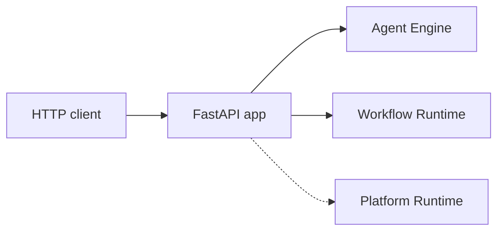

# API

The API exposes the same operations as the [CLI](cli.md) over HTTP.
It's a FastAPI app that forwards requests through to the Agent Engine and
the Workflow Runtime.

The API is small. Most surface area lives in the Agent Engine and the
Workflow Runtime; the API just translates HTTP requests into Agent
Engine calls and streams events back as Server-Sent Events when the
client wants live updates.

## Endpoints

`POST /agents/{agent_ref}/execute` runs an exchange. The request
body carries the trigger and an optional `session_id` (a new session
is created when absent); the response carries the final reply.

`POST /agents/{agent_ref}/execute_stream` runs the same exchange and
streams events as they're produced as Server-Sent Events. The
streaming variant doesn't raise on Fatal failure — the failure
event is the last item in the stream.

`POST /sessions` creates a new session for a given agent.

`GET /sessions` lists sessions.

`GET /sessions/{session_id}/events` returns the JSONL events for a
session.

`PATCH /sessions/{session_id}` updates session metadata (renaming,
starring, archiving).

`DELETE /sessions/{session_id}` deletes a session.

`GET /health` is the liveness probe.

## Principles

**Stateless API process.** The API server holds no session state
across requests. A reload mid-conversation doesn't lose anything;
the next request reads from the event log.

**One Agent Engine instance per process.** The API constructs one
Agent Engine at startup and shares it across requests. Per-thread
locks on the Agent Engine handle concurrent requests on the same
session.

**Streaming is a separate endpoint.** Callers that want incremental
events POST to `/execute_stream` and consume Server-Sent Events.
Callers that want the final result POST to `/execute` and wait for
the synchronous response. The Agent Engine produces the same event
sequence either way.

**No bespoke shapes.** Request and response payloads use the same
Pydantic models the Agent Engine uses internally. The API is a transport,
not a translation layer.

---

The class reference is at [API: HTTP](../api/index.md#http-api).
The OpenAPI schema is auto-generated by FastAPI at `/docs` on the
running server.
