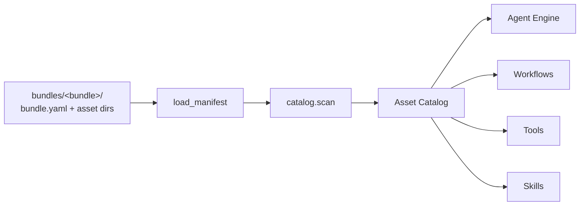

# Assets

Assets are the files that define a Kolsch workspace — agents, tools,
skills, prompts, workflows, and workflow nodes. The Assets subsystem
discovers them across bundles, validates them, and exposes a single
catalog that every other subsystem reads.



A bundle is a directory at `bundles/<bundle>/` containing a
`bundle.yaml` at its root and subdirectories for the asset types it
ships (`agents/`, `tools/`, `skills/`, `prompts/`, `workflows/`,
`nodes/` — any subset). Bundles can ship with the platform
(`kolsch/`), live inside the workspace, or be installed from
elsewhere. The catalog tracks every asset by its bundle of origin —
`kolsch/tools/bash` and `acme/tools/bash` are two different tools,
both addressable by their full 3-segment ref. Nothing is collapsed
or shadowed.

## Bundle layout

```
bundles/
└── <bundle>/
    ├── bundle.yaml          # The manifest (required)
    ├── agents/              # *.yaml — agent definitions
    ├── tools/               # *.py — @tool-decorated functions
    ├── skills/
    │   └── <name>/
    │       ├── SKILL.md     # Frontmatter + body
    │       └── ...          # Supporting files
    ├── prompts/             # *.md — reusable prompt fragments
    ├── workflows/           # *.yaml — workflow definitions
    └── nodes/               # *.py — custom workflow node runners
```

`bundle.yaml` is the only required file. The catalog scanner walks
each asset subdirectory it finds and registers what's there.

## `bundle.yaml` format

```yaml
name: kolsch              # Lowercase alphanumeric, hyphens, underscores
version: "0.1.0"          # Free-form string the bundle author maintains
description: |
  One-line description of what this bundle ships.

required_env_vars:        # Vars the bundle's tools assume exist
  - GITHUB_TOKEN

dependencies:             # Other bundles this one builds on (by name)
  - kolsch

permissions:              # Bundle-level authz rules (optional)
  - what: kolsch/bash
    pattern: "git *"
    effect: allow

exclude:                  # Paths to skip during discovery (optional)
  - nodes/draft_echo.py
  - workflows/wip.yaml
```

`permissions:` is layered: authz checks consult agent rules first,
then bundle rules, then platform rules, then a default-deny tail.
A bundle can declare its own permissions but never widen the
platform's.

`exclude:` is the opt-out list for in-progress drafts. The
workflow/node scanners consult it; the tool/agent/skill scanners
currently don't.

## Types

`AssetCatalog` is the in-memory index built at startup. It maps a
3-segment ref (`<bundle>/<plural>/<name>`) to the loaded asset
record.

`AssetManagement` is the entry point callers use. It exposes the
catalog, loads agent YAML on demand, and resolves prompt refs —
references like `kolsch/prompts/code-review` that appear in an
agent's `prompt:` field — into inline content before handing the
config to the engine.

`BundleManifest` is the parsed `bundle.yaml`. The catalog's
`load_manifest(bundle_dir)` returns one of these per bundle; a
malformed or missing manifest returns `None` and the bundle is
skipped with a warning.

The `assembler` module (a set of module-level functions, not a
class) does the agent-config assembly: walks an agent YAML's
`extends:` chain via the templating layer, merges partials through
the kernel resolver, and pre-resolves prompt refs into inline
content.

## Principles

**One ref format across all asset types.** Every asset is identified
by `<bundle>/<plural>/<name>` (`kolsch/tools/bash`,
`acme/agents/researcher`). One parser, one validator, one writer —
no inline `f"{bundle}/{type}/{name}"` strings anywhere else in the
codebase, because if every caller built refs by string
concatenation, a typo in any of them would produce a "missing
asset" error far from the source of the bug.

**Discovery happens by directory layout.** A file at
`bundles/kolsch/tools/bash.py` defining a `@tool` is automatically
addressable as `kolsch/tools/bash`. No registration step, no
manifest entry needed for individual assets — the file's location
in the bundle is what registers it.

**The catalog is immutable for the lifetime of a process.** It's
built once at bootstrap and shared. Changes to bundle files don't
appear in the running process. To pick up changes, restart the
process. Forcing a rebuild rather than hot-reloading keeps replay
deterministic — a running session sees the same catalog from the
first event to the last. (`kolsch refresh` exists but only re-runs
LLM provider model discovery; it does not rebuild the asset
catalog.)

**Refs are stable identifiers, not content fingerprints.** A
3-segment ref points at the asset's name and location, not its
content. The asset behind a given ref can change between process
runs (an author edits `bundles/kolsch/tools/bash.py` and refreshes).
The ref doesn't change; the resolved record does. If you need to
detect that an asset's content changed, compare what the catalog
loaded against what the previous run loaded — the ref alone won't
tell you.

---

The class reference is at [API: Assets](../api/index.md#assets).
The [Asset management contract](../explanation/asset-management-contract.md)
covers the load order, the merge semantics, and the bundle
distribution model.
