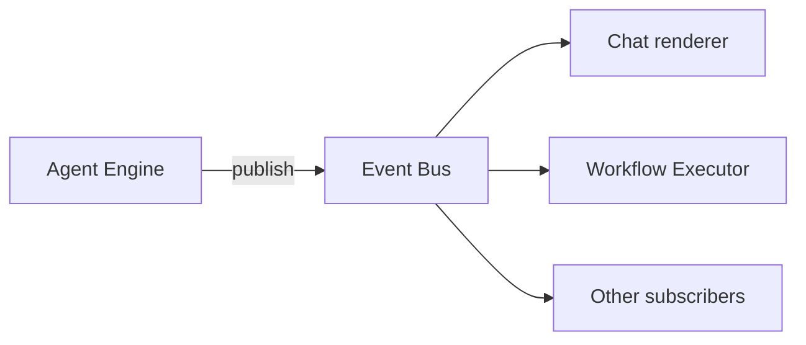

# Bus

The Bus is the runtime event distribution layer. When the Agent Engine
appends an event to the log, it also publishes it on the Bus.
Subscribers — the chat renderer, the workflow runtime, metric
collectors — react in real time without polling the log.

The Bus exposes a thin pub/sub surface: subscribers register a topic
pattern and a handler; publishers append an event. Delivery is
best-effort and non-blocking — a slow handler can't stall the
publisher, and a transport failure can't take down the producer.

## Types

`EventBus` is the protocol every backend implements. The default
backend is `InProcessEventBus` — a Python asyncio fan-out that runs
inside the same process. A Redis-backed backend slots in at the same
protocol surface for cross-process delivery.

`SubscriptionId` is the handle returned by `subscribe`. Pass it back
to `unsubscribe` when the consumer is done.

Topic patterns support exact match (`thread.exchange_completed`),
prefix wildcards (`tool.*`), and the full wildcard (`*`). Filters
layer on top — every filter must match for the handler to receive
the event.

## Principles

**Delivery is best-effort.** A publisher's primary work (appending
to the log) is never broken by a Bus failure. The Bus catches and
logs transport errors; it does not propagate them to the publisher.

**Handlers are isolated from each other.** Publishing delivers to
every matching handler concurrently with `asyncio.gather` and
`return_exceptions=True`. One handler raising doesn't prevent the
others from receiving the event.

**The Bus is not a queue.** Subscribers see events that arrive after
they subscribe. Events that landed before they subscribed are not
replayed. A consumer that needs to catch up on past events reads the
log directly through the [Store](store.md).

**One backend per process at a time.** The in-process backend covers
the local case. The Redis backend covers cross-process delivery. The
caller picks at startup; the choice doesn't leak into the rest of
the platform.

---

The class reference is at [API: Bus](../api/index.md#bus).
The [Event bus contract](../explanation/event-bus-contract.md) covers
the pattern grammar, the filter semantics, and the failure isolation
guarantees.
