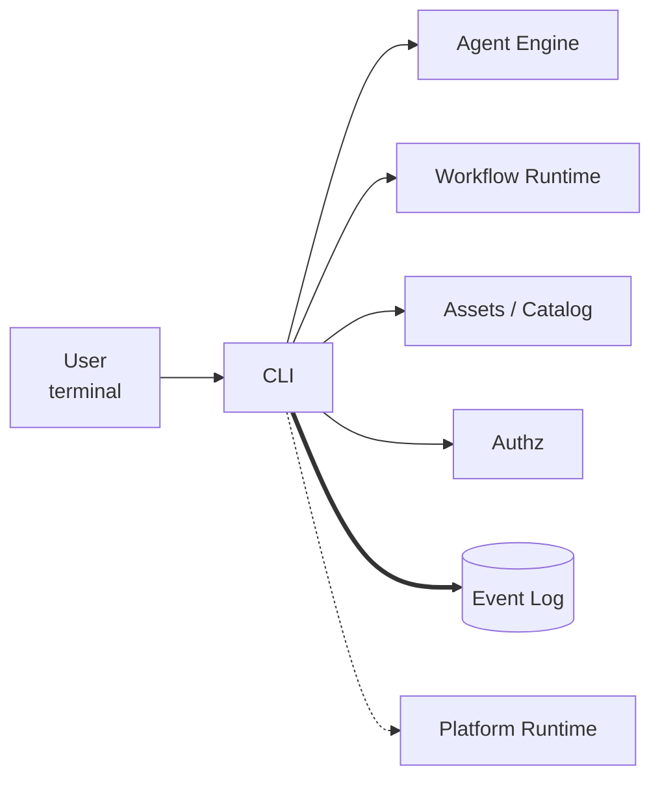

# CLI

The CLI is the user-facing entry point. It runs chat sessions, runs
workflows, manages permissions and sessions, picks models, and walks
new users through `kolsch setup` on a fresh workspace.



The CLI is a thin layer. Commands resolve a workspace, ask the
Platform Runtime to bootstrap the relevant subsystems, then call
through to the Agent Engine or the Workflow Runtime. The CLI doesn't run
agents itself — it sets up the run and renders the events streaming
back.

## Commands

`kolsch setup` walks a new user through connecting at least one LLM
provider and picking a default model. It writes `platform.yaml` and
seeds the starter bundle (`<workspace>/bundles/kolsch/`).

`kolsch chat` starts an interactive chat session. It supports
multi-line input, mid-session model switches, slash commands for
permissions (`/perm`), and resuming a prior session with `--session`.

`kolsch run` invokes a single agent for one exchange and prints the
final reply (or one model call in `single_shot` mode); `--model <ref>`
overrides the model for that one run. Workflows have their own verb:
`kolsch workflows run <ref>` — e.g. the starter
`kolsch/workflows/triage-tickets-jev`, which routes a ticket three ways
on a `kolsch/nodes/jev` decision. A failed `kolsch run` exits `2` and
prints a short error block instead of a traceback (see
[Failure output and logging](#failure-output-and-logging)).

`kolsch models`, `kolsch nodes` (workflow node definitions — the 16
built-ins plus any authored `@node`s),
`kolsch skills`, `kolsch sessions`, `kolsch permissions`,
`kolsch workflows`, and `kolsch providers` are catalog and
management commands — listing what's installed, what's been run, and
what permissions are active. `kolsch connect` and `kolsch disconnect`
wire LLM providers up to the workspace; `kolsch refresh` re-runs
model discovery against the connected LLM providers.

`kolsch server` starts the HTTP API. `kolsch reconstruct` rebuilds
the entity records (sessions, threads) from the JSONL event log —
useful after moving a workspace or recovering from corruption.

`kolsch mcp` exposes kolsch over the Model Context Protocol: `mcp serve`
runs a read-only operator server (list sessions, read events) that an
external agent can drive over stdio, and `mcp bridge` bridges the
running session's tools to an in-workflow external-harness agent.
`kolsch doctor` diagnoses a workspace — provider connectivity, catalog
integrity, and common misconfigurations, including (advisory) a missing
or misplaced authorization default-deny tail, and an "Agent write
access" section that lists the paths agents can never write and flags
`allow` rules for `bash`, and `write_file` allows that point into
`bundles/` or use a `*` pattern.

## Failure output and logging

When an agent exchange fails in an ordinary way (bad credentials, an
upstream 4xx/5xx, a timeout), `kolsch run` exits `2`, writes nothing to
stdout, and prints one block to stderr, rendered from the durable
`thread.exchange_failed` event:

```text
error: kolsch/agents/helper failed — model.timeout: <message>
  cause:   <one line from the underlying error, at most 300 characters>
  session: ses_…
  inspect: kolsch sessions events ses_…
```

The `cause:` line is left out when the error carries none. Pre-flight
problems — an unknown agent, a bad `--model`, a malformed or unknown
`--session`, a session with no threads, an unknown `--skill` — print a
single `error: …` line (plus a hint where one helps) and also exit `2`.
An exception that is not an ordinary failure is a kolsch bug; it prints
`error: <agent> failed with an internal error (<Type>): <message>` and
points at `kolsch -v` and the log file.

**What `-v` adds.** `-v` is a top-level flag, so it goes before the
command: `kolsch -v run …`. Without it, stderr shows WARNING and above
from kolsch's own loggers only. With it, stderr shows INFO and above
from every logger — third-party libraries included (CrewAI, the OpenAI
SDK, httpx) — and the traceback after the failure block. CrewAI's own
console panels are always suppressed; their text is the same as the
third-party log records.

**`<workspace>/logs/kolsch.log`.** Every command run against an
initialized workspace (including read-only ones like `kolsch sessions
list`) creates this file if needed and appends every log record at INFO
and above, from every logger, with timestamp, process id, level and
logger name — whether or not `-v` is set. Failure tracebacks are always
written here. It rotates at 5 MB and keeps 3 backups, shared by all
kolsch processes on the workspace (concurrent rotations may drop or
interleave a few lines). It records request URLs. kolsch never logs
API keys or request headers; provider error bodies are logged verbatim
(some providers echo a masked key fragment). With no initialized
workspace (`kolsch setup` on a new path, or `kolsch doctor` /
`kolsch mcp bridge` pointed at one), logs go to stderr only.

## Principles

**The CLI doesn't hold agent state.** Everything visible to the user
— chat history, permission decisions, model fallback choices — is
derived from the event log on disk. Killing and restarting the chat
reconstructs the same view. If state lived only in CLI memory, a
crashed terminal would lose what the user could see.

**The renderer is a pure event consumer.** The chat surface
subscribes to events from the Agent Engine and renders them. It doesn't
invent UI state that isn't on the event stream. If the renderer
forked state, two surfaces watching the same session (chat in one
terminal, an API client in another) would drift, and a replay from
the log wouldn't reproduce what the user saw.

**Slash commands modify state through the same APIs as the YAML.**
`/perm allow kolsch/bash` writes a permission rule the same way
editing `platform.yaml` does. There's no parallel UI-only state, so
a user who configures everything by hand sees the same result as one
who uses the slash commands.

**Setup is opinionated but optional.** `kolsch setup` produces a
working workspace fast, but every choice it makes can be overridden
by editing the YAML files it generates. Power users skip setup
entirely and write the config by hand.

**Every subcommand has a smoke test.** Each top-level subcommand has
a test in `tests/component/test_cli_smoke.py` that spawns a fresh
Python subprocess and runs it. The smoke suite catches the class of
bug where the dispatcher routes a command to the wrong handler —
the kind of bug that only surfaces when the CLI runs as a separate
process, not in-process from a test.

---

The class reference is at [API: CLI](../api/index.md#cli).
The setup flow, the chat surface, and the slash-command catalog are
covered in the [how-to guides](../how-to/README.md).
