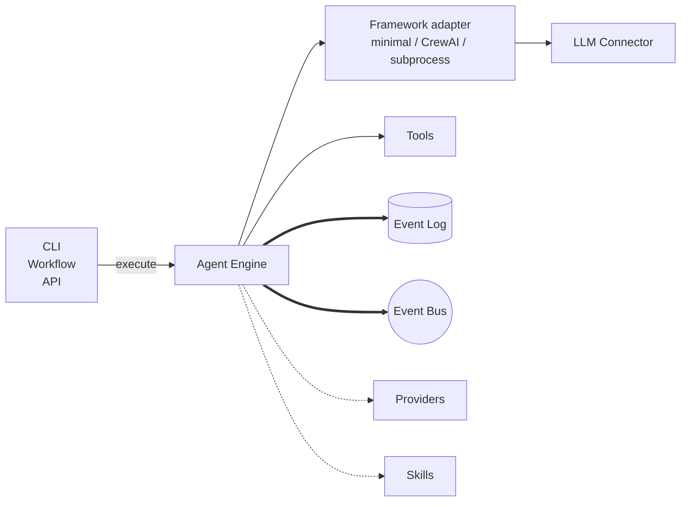

# Agent Engine

The Agent Engine runs one configured agent through one exchange. An
*exchange* is one user message (or single-shot input) and everything
that follows it — model calls, tool calls, retries — through to the
agent's final reply.

The Agent Engine doesn't talk to the model directly. It drives a framework
adapter (a built-in minimal loop by default, CrewAI as an opt-in
alternative, or a subprocess/external-harness adapter) that knows how to
hold an agent loop and a tool-use protocol. The framework calls the
LLM. The LLM replies with text or with a tool-use request. When it's
a tool-use request, the framework hands it back to the Agent Engine; the
Engine looks up the tool, runs it (subject to authorization), and
feeds the result back into the framework for the next turn.

The Agent Engine is constructed once at startup and lives for the lifetime
of the process. Callers — chat, workflows, the HTTP API — invoke
`execute` (synchronous; returns the final reply) or `execute_stream`
(asynchronous iterator over events as they're produced). Each call
gets a fresh `ExecutionContext`.

## Types

`AgentEngine` is the top-level coordinator. Its constructor takes
every subsystem the Agent Engine collaborates with: store, bus, asset
management, tools, skills, memory, sandbox, secrets, authz,
framework, and the LLM factory (plus the LLM providers config the
factory consults).

`ExecutionContext` carries the thread to run on (the conversation
history being appended to) and the trigger that started the exchange.
A trigger is one of: a user message (normal chat), a force-invoke
message (the engine triggers a specific tool call without waiting
for the model to ask), or single-shot inputs (one model call with no
follow-up). It optionally carries a cancellation token, a workflow
trace ID, and a chain of callers for audit logs.

`CancelToken` is the cancellation handle. The Agent Engine checks it
between framework turns and just before each LLM call.

`EngineCapabilities` reports what the Agent Engine supports — version,
modes (`single_shot`, `conversational`), features (`tool_use`,
`force_invoke`), and which LLM providers are wired up.

`AgentExecutionError` is what `execute` raises when an exchange fails
fatally. It carries the `thread.exchange_failed` event so callers can
read why. `execute_stream` does not raise; the failure event is the
last item in the stream instead.

## Principles

**Stateless across exchanges.** Per-thread locks live on the Agent Engine
instance for concurrency safety. Everything else — the framework
instance, the LLM client, the in-flight event chain — is built fresh
on every `execute` call. This keeps two concurrent exchanges from
corrupting each other's framework state, and it means a replay from
the JSONL reconstructs the exact same execution path.

**Two APIs, same work.** `execute_stream` streams each event as the
Engine produces it. `execute` collects the stream and returns the
final `agent.message`. The streaming variant doesn't raise on
failure. Pick by error-handling style; the logged event sequence is
identical.

**The framework is a choice, not a lock-in.** The default is
`MinimalFramework` — a built-in loop that talks to the LLM seam,
dispatches tool calls, and iterates. `CrewAIFramework` is an opt-in
alternative that wraps CrewAI for extra production affordances
(cancellation during a hung call, retry translation, tracing
suppression); pass it explicitly. `SubprocessAgentFramework` is
auto-selected for external-harness agents (e.g. Claude Code): the
harness runs the loop itself and reaches kolsch tools through the MCP
tool bridge. All three sit behind the `Framework` protocol; either way
the Engine only records, it never reimplements the loop. Tests run the
same `MinimalFramework` against a mock LLM driver, so they burn no
tokens.

**The LLM client is per-exchange.** The Agent Engine doesn't hold an LLM
client across exchanges. Each call resolves the model spec, calls
`build_llm`, and lets the framework own the client for that
exchange. As a result, two consecutive exchanges on the same thread
can target different models without interference.

**Cancellation is cooperative.** Nothing kills work in flight. The
`CancelToken` is checked at safe points — between framework turns,
before each LLM call, by tools that opt in — because hard-killing a
tool mid-call could leave external state (a half-written file, a
half-sent API call) in an inconsistent place. In-flight work runs to
its natural completion or stops at the next cancellation check.

---

The class reference is at [API: Engine](../api/index.md#engine-execution-context).
The [Engine contract](../explanation/agent-engine-contract.md) covers
event ordering, replay determinism, and what observers see — the
guarantees this page summarizes.
