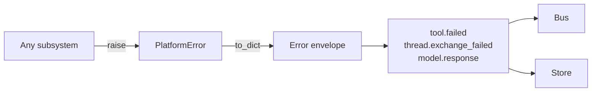

# Errors

Errors is the `PlatformError` hierarchy. Every error raised across a
module boundary is a `PlatformError` subclass with a registered code
and a severity level: diagnostic, recoverable, or fatal. The level
tells the Agent Engine what to do with it; the code identifies the
specific failure for catalogs, dashboards, and tests.

When a module raises, the boundary catches the `PlatformError`,
converts it to the canonical `Error` shape, and writes it as event
data. The Agent Engine reads the level to decide whether to retry
internally, surface to the model, or end the exchange.

## Severity levels

**Diagnostic** errors are informational. The Agent Engine writes them as
events, and the framework includes the event in the next prompt the
model sees. The model reads the failure (e.g. "tool returned no
matching files"), and decides whether to try again with different
arguments, ask the user for clarification, or move on. The exchange
continues.

**Recoverable** errors are transient failures the engine can retry
without involving the model. A `model.rate_limited` from one provider
triggers a switch to the next model in `fallback_models` (see
[LLM Connectors](llm.md#principles)). A `store.lock_timeout` retries
the write. If retries are exhausted, the error promotes to fatal.

**Fatal** errors end the exchange. The Agent Engine writes a
`thread.exchange_failed` event with the error attached and propagates
it to the caller — the sync `execute` raises `AgentExecutionError`;
the streaming `execute_stream` yields the failed event as its last
item.

## Types

`PlatformError` is the base. Every subclass declares a code
(`tool.unauthorized`, `store.corrupt_log`, `model.rate_limited`) and
a level (one of `Level.DIAGNOSTIC`, `Level.RECOVERABLE`,
`Level.FATAL`).

`Error` is the canonical envelope. It mirrors `PlatformError.to_dict`
output as a Pydantic model. The envelope appears on event payloads
(`tool.failed.data.error`, `thread.exchange_failed.data.error`,
`model.response.data.error`) so consumers always see the same shape.

`Level` is the severity enum.

Per-subsystem error modules (`errors.engine`, `errors.tools`,
`errors.store`, etc.) hold the subclasses for that subsystem. Each
class has a one-line "Raised when…" docstring naming the failure
condition.

## Principles

**Levels are decided by the error class, not by the caller.** A
`ModelRateLimited` is recoverable regardless of where it's raised.
The classification lives on the class, so a `try/except` upstream
can't accidentally treat a recoverable error as fatal (or the
reverse) by misreading the situation.

**Every module boundary wraps foreign exceptions.** Subsystems catch
foreign exceptions at their public surface and wrap them in a
`PlatformError`. A non-`PlatformError` never escapes a public method,
because if it did, the caller would have to know about every
third-party library's exception hierarchy to handle errors safely.

**Codes are stable, descriptive, and greppable.** Codes are
dot-separated strings (`authz.denied`, `platform.internal_error`)
that read like log fields. Tests assert on codes; dashboards group
by them. Renaming a code is a breaking change.

**Recoverable means recoverable.** A new error code that genuinely
ought to trigger retry/fallback must declare `Level.RECOVERABLE` in
the same change that introduces it. Codes that default the level
silently default to "not recoverable," which is wrong for any
transient condition.

---

The class reference is at [API: Errors](../api/index.md#errors).
The [Error model contract](../explanation/error-model.md) covers the
wrapping rules at module boundaries and the `recovery_hint` field
on `tool.failed` events.
