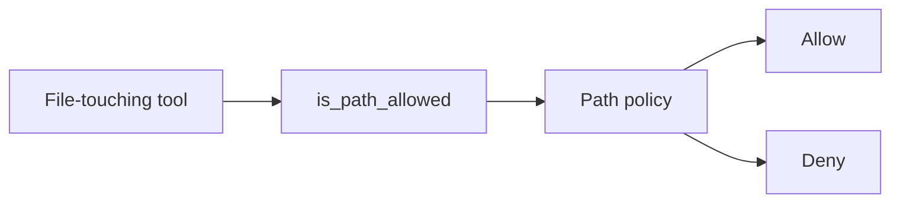

# Files

Files holds the path policy that file-touching tools (`read_file`,
`write_file`, `list_files`, `bash`) honor. It draws the boundary
between paths a tool can touch and paths it can't, and exposes a
small set of functions the tools call before they act.

A tool that wants to read or write a path passes it through
`is_path_allowed` (or its raising sibling `check_path_allowed`). The
policy compares the path against the workspace root and the
`allowed_paths` / `denied_paths` lists configured in `platform.yaml`.
The tool gets back an allow or a deny with a reason string and the
matched rule.

## Types

`PathPolicy` is the policy object. It holds the allow list, the
deny list, and (optionally) the workspace root. The platform
runtime builds one at startup from `platform.yaml`'s
`file_access` section.

`is_path_allowed(path, *, policy, root) -> tuple[bool, str | None]`
is the boolean entry point. It returns `(True, None)` on allow and
`(False, reason)` on deny — the reason string names which rule
denied the path.

`check_path_allowed(path, *, policy, root) -> None` is the raising
variant — returns nothing on allow, raises `FileAccessDenied` on
deny.

`evaluate_path(path, *, policy, root) -> _PathDecision` is the
internal lookup that the two functions above use. It returns the
allow/deny decision, a reason string, and the matched rule. Most
tool authors call the public wrappers; only the dispatch internals
reach for `_PathDecision` directly.

`assert_writable_destination(path, *, root)` is a separate guard for
write paths. It blocks writes under `content/` (the sidecar store
the engine owns) regardless of policy. It does NOT run the full
path policy; tools that write also call `check_path_allowed` first.

## Principles

**Tools call the policy; the policy doesn't call tools.** The policy
functions take a path, a policy object, and the workspace root, and
return a decision. They have no side effects, no caching, no
telemetry. Tools own the decision to honor or reject what the
functions return.

**Allow lists are explicit.** A path is denied unless it's covered
by an allow rule. There's no implicit "the workspace root is
allowed" fallback — even `kolsch/read_file` against a file in the
workspace runs through `is_path_allowed` and gets back an explicit
decision.

**The `content/` sidecar is hard-denied for writes.**
`assert_writable_destination` blocks any write under `content/` by
code, not by configuration. No `platform.yaml` setting can let a
tool write into the content sidecar — that would let a malicious
agent corrupt the engine's own storage.

**Defaults deny dotfiles people usually want to protect.** The
default `platform.yaml` ships `.env` and `.platform/` in
`denied_paths`. These are policy defaults — a workspace owner can
edit them — so they're protected by convention rather than by code.
`.git/` is not denied by default, so make sure to add a rule if you
want it off-limits.

---

The class reference is at [API: Files](../api/index.md#files).
The [File handling contract](../explanation/file-handling.md) covers
the allow / deny list syntax and the file-tool expectations.
