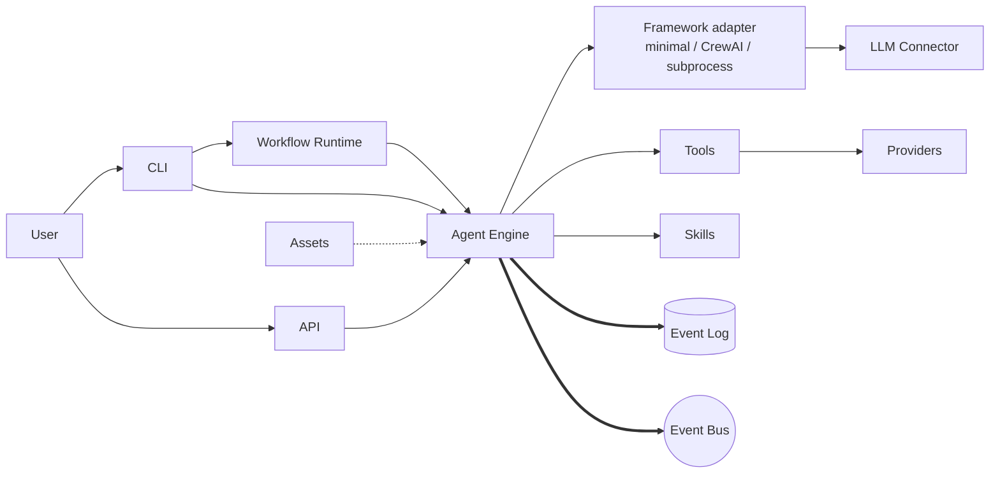

# Architecture

Kolsch is a local-first agent harness. Agents, tools, skills, and
workflows live in YAML; a Python backend runs them and writes every
step to JSONL.

Two layers run an agent: the **Agent Engine**, which runs one agent
through a single *exchange* (one user message through to the agent's
final reply, including any tool calls in between), and the
**Workflow Runtime**, which coordinates a job with more than one
agent by calling the Engine once per agent step. A user reaches
either one through the CLI or the HTTP API: both call the Engine
directly for single-agent chat and one-shot runs; multi-agent jobs
go through the Workflow Runtime instead, which today is a CLI-only
entry point (`kolsch workflows run`). Every exchange the Engine runs
is recorded to the event log, whichever layer triggered it.

Bold arrows are the events the runtime writes for every step. The
dashed arrow is the asset catalog being pulled in at startup. Solid
arrows are runtime calls. The framework adapter runs the agent
loop — a built-in minimal loop by default, CrewAI as an opt-in
alternative, or a subprocess adapter that drives an external harness
(e.g. the Claude Code CLI) — so the loop can be swapped without
touching the Agent Engine.

## Subsystems

### Entry points

- [CLI](cli.md) — chat, workflow runs, permissions, sessions.
- [API](api.md) — execute and session operations over HTTP; workflow
  runs are CLI-only today.
- [MCP Server](mcp_server.md) — two surfaces over the Model Context
  Protocol: `kolsch mcp serve` for read-only observability, and
  `kolsch mcp bridge` for an external harness to call kolsch's own
  tools (denylist-gated).

### Running agents and workflows

- [Workflows](workflows.md) — coordinates jobs across multiple
  agents.
- [Engine](engine.md) — runs one agent per exchange.
- [Tools](tools.md) — the `@tool` decorator; routes tool calls from
  the LLM back to Python functions.
- [Skills](skills.md) — declarative augments to agent prompts.

### Composing configuration

- [Assets](assets.md) — finds agent, tool, skill, and workflow
  definitions across bundles.
- [Kernel](kernel.md) — merges agent configuration partials using
  JSON Merge Patch (RFC 7386).
- [Templating](templating.md) — renders agent prompts with Jinja2.

### Persistence and events

- [Store](store.md) — the JSONL event log; entity records run on
  SQLite today. The backend sits behind a protocol so a Postgres
  backend can be added without touching callers — not yet built.
- [Bus](bus.md) — distributes events at runtime; in-process only
  today, behind a protocol built for a future Redis backend
  (cross-process delivery) — not yet built.

### Cross-cutting concerns

- [Providers](providers.md) — memory, secrets, sandbox, and
  authorization, each swappable per workspace.
- [LLM Connectors](llm.md) — OpenRouter, OpenCode, and Claude Code,
  plus a mock provider for tests.
- [Files](files.md) — the path policy that file-touching tools have
  to honor.

### Foundations

- [Schemas](schemas.md) — shared types: identifiers, entities,
  events, and config.
- [Errors](errors.md) — every `PlatformError` grouped by severity:
  diagnostic (informational), recoverable (retried internally), or
  fatal (ends the exchange).
- [Platform Runtime](platform-runtime.md) — resolves the workspace
  and bootstraps the whole thing.
