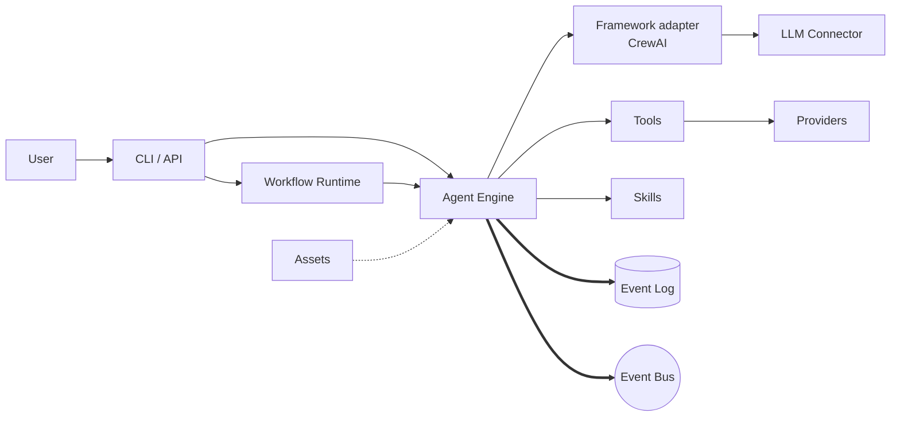

# Architecture

Kolsch is a local-first agent harness. Agents, tools, skills, and
workflows live in YAML; a Python backend runs them and writes every
step to JSONL.

A user message goes to the CLI or the HTTP API. From there it goes
either to the Workflow Runtime (for jobs that involve more than one
agent) or directly to the Agent Engine (for single-agent chat). The
Engine runs one *exchange* — one user message through to the agent's
final reply, including any tool calls in between — and records it
to the event log.

Bold arrows are the events the runtime writes for every step. The
dashed arrow is the asset catalog being pulled in at startup. Solid
arrows are runtime calls. The Workflow Runtime is the layer that
handles jobs with more than one agent; the Agent Engine runs one agent at
a time. The framework adapter is the wrapper around the third-party
agent library — CrewAI by default — so the library can be swapped
without touching the Agent Engine.

## Subsystems

[CLI](cli.md) and [API](api.md) are the entry points. The CLI handles
chat, workflow runs, permissions, and sessions; the API exposes the
same operations over HTTP.

[Workflows](workflows.md) coordinates jobs across multiple agents.
[Engine](engine.md) runs one agent per exchange. [Tools](tools.md)
holds the `@tool` decorator and routes tool calls from the LLM back
to Python functions. [Skills](skills.md) supplies declarative augments
to agent prompts.

[Assets](assets.md) finds agent, tool, skill, and workflow definitions
across bundles. [Kernel](kernel.md) merges agent configuration
partials using JSON Merge Patch (RFC 7386). [Templating](templating.md)
renders agent prompts with Jinja2.

[Store](store.md) is the JSONL event log; SQLite (default) or Postgres
backs the entity records. [Bus](bus.md) distributes events at
runtime; in-process by default, Redis for cross-process delivery.

Memory, secrets, sandbox, and authorization sit behind protocols you
can swap per workspace. [Providers](providers.md) covers all four.
[LLM Connectors](llm.md) wires up Anthropic, OpenRouter, OpenCode,
and a mock provider for tests. [Files](files.md) enforces the path
policy that file-touching tools have to honor.

[Schemas](schemas.md) defines the shared types — identifiers,
entities, events, and config. [Errors](errors.md) groups every
`PlatformError` by severity: diagnostic (informational), recoverable
(retried internally), or fatal (ends the exchange).
[Platform Runtime](platform-runtime.md) resolves the workspace and
bootstraps the whole thing.
