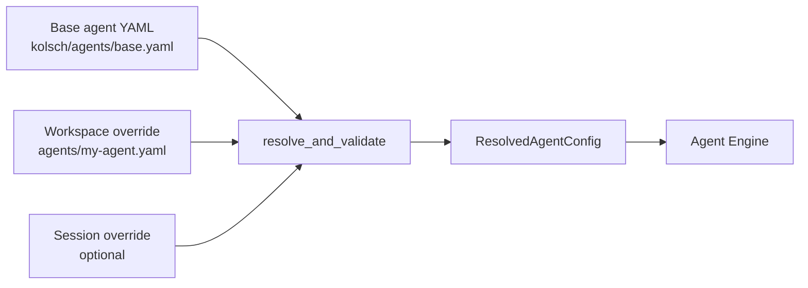

# Kernel

The Kernel is the agent-config resolver. An agent in Kolsch is
defined by a chain of YAML partials — a base agent file in a bundle
can be extended by a workspace agent, which can be further extended
by a session-specific override. The Kernel merges these partials
into one fully-resolved `ResolvedAgentConfig` the Agent Engine consumes.



Merging uses JSON Merge Patch — the IETF standard (RFC 7386) for
saying "here's what's different about this layer vs. the one below."
Each partial declares only its overrides; the resolver applies them
root-to-leaf and produces one merged document. The pipeline runs
three validation layers around the merge and turns the final
document into the typed `ResolvedAgentConfig`.

## What the Kernel manages

The Kernel resolves **agent configurations only**. It does not
touch `platform.yaml`, `bundle.yaml`, workflow YAML, or skill
frontmatter — those are read directly by the subsystems that own
them (the Platform Runtime reads `platform.yaml`; the Assets
subsystem reads `bundle.yaml`; the Workflow runtime parses workflow
YAML; the skills validator reads SKILL.md frontmatter).

Agent partials all conform to the same shape — the same fields as
`ResolvedAgentConfig`, but with every field optional so a partial
that overrides only `model:` can be merged onto a base that supplies
the rest.

### Partial format

A partial is a YAML file with any subset of the agent fields:

```yaml
extends: kolsch:agents/base      # Optional — the parent ref

agent_id: my-agent               # Required at the resolved layer
name: My agent
description: One-line description

model:                           # The LLM to use
  provider: openrouter
  model: anthropic/claude-3.5-sonnet
  parameters:
    temperature: 0.2
  fallback:                      # Backup models for recoverable errors
    - provider: openrouter
      model: openai/gpt-4o-mini

prompt: |                        # Inline prompt, or a list of layers
  You are an assistant that...

io:                              # The trigger / reply shape
  mode: conversational           # or "single_shot"

runtime:                         # Engine-tuned knobs
  max_retries: 2
  timeout_seconds: 60

subsystems:                      # Per-subsystem config blocks
  memory:
    variant: recent_buffer
    config:
      max_messages: 50
  skills:
    config:
      enabled:
        - { ref: kolsch/skills/code-review }

permissions:                     # Agent-level authz rules
  - what: kolsch/bash
    pattern: "git status"
    effect: allow

context_files:                   # Files inlined into the prompt
  - path: workspace:README.md
    primary: true
```

## Types

`resolve(partials)` is the merge entry point. It takes a list of
partials in root-to-leaf order (the base agent first, then each
override) and returns the merged document.

`resolve_and_validate(partials, subsystem_validators, system_validators=None)`
is the full pipeline. It runs the three validation layers — Layer 1
on each partial (shape check), the merge, Layer 1 on the resolved
document, then Layer 2 (cross-field invariants) and Layer 3
(subsystem-specific validation using the passed-in validators) — and
returns either a typed `ResolvedAgentConfig` or a `ValidationError`
list naming what's wrong.

`PartialAgentConfig` is the Pydantic model for a partial. Every
field is optional; the merge fills the gaps from the layers below.

`ValidationError` is the structured failure record. It carries the
layer (1, 2, or 3) and a message naming the field and the rule that
failed.

The two follow-up passes — applying defaults from `platform.yaml`
and pre-resolving prompt refs into inline content — happen in the
Assets subsystem (`assets.asset_manager.build_resolved_config`), not
in the Kernel. The Kernel produces a structurally-valid resolved
config; Assets adds the defaults and prompt content the Agent Engine
needs.

## Principles

**RFC 7386 is the merge spec.** Standard JSON Merge Patch semantics:
nested objects merge recursively, scalars and arrays replace, `null`
deletes. No custom merge rules.

**No I/O in the merge.** `resolve` takes parsed dictionaries and
returns a parsed dictionary. File reads, network calls, and config-
source resolution happen upstream. This keeps the merge fast,
deterministic, and easy to test — a unit test passes literal dicts
in and asserts on the literal dict out.

**Validation runs at three layers.** Layer 1 (shape) runs on each
partial AND on the merged result, so a malformed override gets
caught before it can corrupt the merge. Layer 2 (cross-field) and
Layer 3 (subsystem-specific) run only after the merge, since they
need the full resolved view to evaluate invariants like "the
enabled skills exist in the catalog."

**Failures are structured.** The pipeline collects `ValidationError`
records rather than raising on the first bad value. Callers see
every problem at once instead of fixing them one at a time.

---

The function reference is at [API: Kernel](../api/index.md#kernel).
The [Kernel resolver contract](../explanation/kernel-resolver-contract.md)
covers the layering rules, the merge precedence, and the validation-
layer responsibilities in detail.
