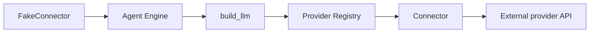

# LLM Connectors

LLM Connectors are how Kolsch talks to language model APIs. Each
connector knows the request and response shapes for one provider.
The two production connectors today are OpenRouter (the broadest
catalog, routes to Anthropic, OpenAI, and others) and OpenCode (the
local-model gateway). Anthropic and other vendors are reachable
through OpenRouter; a direct Anthropic connector hasn't shipped yet.

A `ModelSpec` (`{provider, model}`) names which connector to use and
which model to ask for. When the Agent Engine starts an exchange, it
resolves the spec, calls `build_llm`, and gets back a configured
`crewai.LLM` for the chosen provider. The framework owns the client
for the duration of the exchange.

## Types

`ProviderConnector` is the protocol every connector implements. It
exposes `build_llm(model_id, provider_config, api_key) -> crewai.LLM`
plus `discover_models(credentials, base_url)`,
`validate_credentials()`, and `auth_prompt_spec()` for the
`kolsch connect` flow.

The connector registry lives in `llm.registry` — connectors register
at import time via `register(type_name, connector)`. The two
registered types today are `opencode` and `openrouter`.

`ProviderConfig` is the per-connector configuration block under
`platform.yaml`'s `llm_providers`. It holds the API key reference,
the base URL, the default model, and any provider-specific
parameters.

`EchoLLMDriver` is the deterministic dev LLM used by tests. It
sits at a different layer than a `ProviderConnector` — it's an
`LLMRequest → LLMResponse` callable the engine accepts directly via
its `llm=` constructor argument. Tests pass it in to bypass the
connector machinery entirely.

## Principles

**Connectors are plain Python classes.** No code generation, no
schema-driven scaffolding. A new connector is a class that
implements the protocol.

**Secrets stay in `.env`.** The `platform.yaml` `llm_providers`
section references secret names; the Secrets provider resolves them
at startup. API keys never appear in YAML or in code paths other
than the connector's `build_llm`.

**One LLM client per exchange.** The Agent Engine asks for a fresh client
per `execute` call. The connector owns construction cost (HTTP
session setup, auth header signing); the framework owns the client
for the exchange's duration. Two exchanges on the same thread can
target different models because neither holds onto the other's
client.

**Fallback is a list on the config.** A `ResolvedAgentConfig`
declares `fallback_models` — an ordered list of backup `ModelSpec`s
the engine walks on recoverable errors (rate limits, transient
failures). Each transition writes a `model.fallback` event. Putting
the fallback chain on the config (rather than wrapping the connector
in a retry handler) means the same chain is declared per agent,
visible in the YAML, and audited in the event log.

---

The class reference is at [API: LLM Connectors](../api/index.md#llm-connectors).
The [LLM providers contract](../explanation/llm-providers.md) covers
the connector protocol, the registration flow, and the fallback
event semantics.
