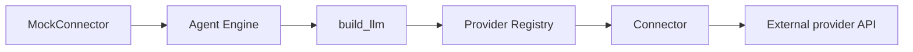

# LLM Connectors

LLM Connectors are how Kolsch talks to language model APIs. Each
connector knows the request and response shapes for one provider.
The production connectors today are OpenRouter (the broadest catalog,
routes to Anthropic, OpenAI, and others), OpenCode (the local-model
gateway), and Claude Code (drives the `claude` CLI under a Claude
subscription, no API key). Anthropic is also reachable through
OpenRouter; there's no direct Anthropic-API connector.

A `ModelSpec` (`{provider, model}`) names which connector to use and
which model to ask for. When the Agent Engine starts an exchange, it
resolves the spec, calls `build_llm`, and gets back a configured
`crewai.LLM` for the chosen provider. The framework owns the client
for the duration of the exchange.

## Types

`ProviderConnector` is the protocol every connector implements. It
exposes `build_llm(model_id, provider_config, api_key, parameters,
*, context) -> crewai.LLM` plus `discover_models(credentials, base_url)`,
`validate_credentials()`, and `auth_prompt_spec()` for the
`kolsch connect` flow.

The connector registry lives in `llm.registry` — connectors register
at import time via `register(type_name, connector)`. The three
registered types today are `claude_code`, `opencode`, and `openrouter`.

`ProviderConfig` is the per-connector configuration block under
`platform.yaml`'s `llm_providers`. It holds the API key reference,
the base URL, the model catalog, an optional `request_policy`
override, and any provider-specific parameters. Every entry is built
and validated by one factory, `provider_config_from_yaml`, shared by
the runtime and `kolsch connect` / `refresh`.

`LLMCallContext` is the per-call request context the engine passes to
every `build_llm`: the owning `session_id`, a derived
`conversation_key` (v1: equal to the session id), and the `agent_id`.
OpenAI-compatible connectors forward the key in the headers their
request policy names (OpenCode: `x-opencode-session`) and identify
themselves as `User-Agent: kolsch/<version>`. See
[LLM providers §3.6](../explanation/llm-providers.md#36-per-call-request-context-request-policy-and-user-agent-bug-144).

`EchoLLMDriver` is the deterministic dev LLM used by tests. It
sits at a different layer than a `ProviderConnector` — it's an
`LLMRequest → LLMResponse` callable the engine accepts directly via
its `llm=` constructor argument. Tests pass it in to bypass the
connector machinery entirely.

## Principles

**Connectors are plain Python classes.** No code generation, no
schema-driven scaffolding. A new connector is a class that
implements the protocol.

**Secrets stay in `.env`.** The `platform.yaml` `llm_providers`
section references secret names; the Secrets provider resolves them
at startup. API keys never appear in YAML or in code paths other
than the connector's `build_llm`.

**One LLM client per exchange.** The Agent Engine asks for a fresh client
per `execute` call. The connector owns construction cost (HTTP
session setup, auth header signing); the framework owns the client
for the exchange's duration. Two exchanges on the same thread can
target different models because neither holds onto the other's
client.

**Conversation identity is derived, not stored.** The key a provider
sees for a conversation is computed from the session id, never minted
by a connector, so it can always be rebuilt from the event log. It is
stable within a session (and across resume), new after `/new`, and
separate for each spawned workflow-node session.

**Fallback is a list on the config.** A `ResolvedAgentConfig`
declares `fallback_models` — an ordered list of backup `ModelSpec`s
the engine walks on recoverable errors (rate limits, transient
failures). Each transition writes a `model.fallback` event. Putting
the fallback chain on the config (rather than wrapping the connector
in a retry handler) means the same chain is declared per agent,
visible in the YAML, and audited in the event log.

---

The class reference is at [API: LLM Connectors](../api/index.md#llm-connectors).
The [LLM providers contract](../explanation/llm-providers.md) covers
the connector protocol, the registration flow, and the fallback
event semantics.
