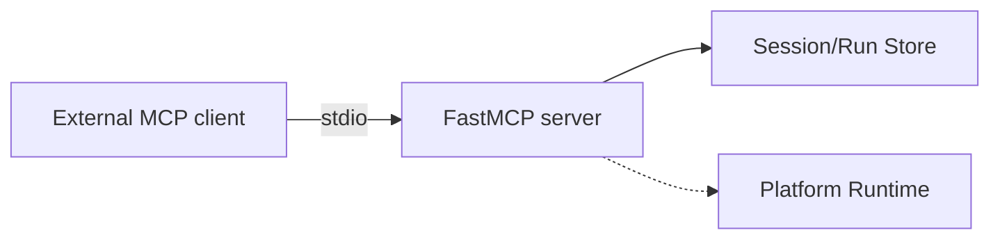

# MCP Server

The MCP server exposes kolsch over the [Model Context
Protocol](https://modelcontextprotocol.io) so an *external* agent can
observe and orchestrate a workspace. It is a third entry surface
alongside the [CLI](cli.md) and [API](api.md): `kolsch mcp serve` runs a
stateless stdio server that any MCP client can drive — Claude Code in
headless mode (`claude -p --mcp-config`) is one such client.

This is **Surface B** — observe-and-orchestrate from outside. It is
distinct from **Surface A**, the in-workflow [tool bridge](tools.md)
(`kolsch mcp bridge`), which lets an external harness call a running
session's tools from *inside* an exchange. Surface B never enters the
engine; it only reads.

## Tools

Two read-only tools ship, each mirroring an existing HTTP endpoint:

- `list_sessions` — lists sessions, wrapping
  `runtime.store.list_sessions(...)` (mirrors `GET /sessions`).
- `read_session_events` — returns a session's events (mirrors
  `GET /sessions/{id}/events`).

Both are pure reads. There are no write or execute tools on this
surface — mutation stays behind the CLI and HTTP API, which apply the
authorization rules.

## Principles

**Read-only by design.** The operator server observes; it does not run
agents or mutate state. Write/execute tools are deferred pending a
principal rework, so an external client can never widen what a
workspace's agents are allowed to do.

**Stateless.** `build_server(runtime)` binds a `FastMCP` server to a
runtime and returns it; each tool call reads fresh from the store.
Nothing is held between calls, so a restart loses nothing.

**Stdout hygiene is a hard guard.** stdio MCP speaks JSON-RPC over
stdout, so `run_stdio` redirects any stray user-code prints to stderr —
a single stray `print` would otherwise corrupt the protocol stream.

**Packaged as `mcp_server`, not `mcp`.** The module lives at
`src/mcp_server/` (not `src/mcp/`) to avoid colliding with the MCP SDK's
own top-level `mcp` package on intra-package imports. The user-facing
`kolsch mcp serve` subcommand name is unchanged.

---

The class reference is at [API: MCP Server](../api/index.md#mcp-server).
The [operator-server how-to](../how-to/mcp-operator-server.md) covers
connecting an external client and the authorization posture in depth.
