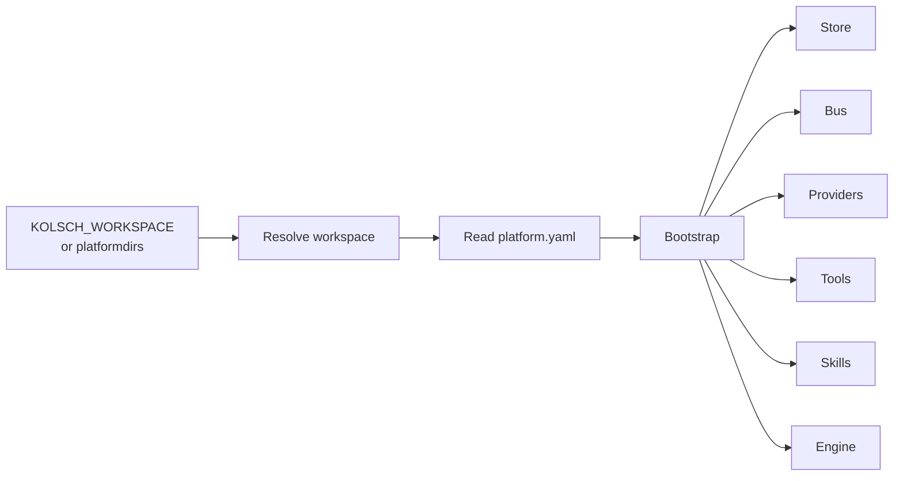

# Platform Runtime

The Platform Runtime is where everything gets wired together. It
reads `platform.yaml`, finds the workspace, constructs every
subsystem in the right order, and hands a ready-to-use platform to
the CLI and the API.

Resolution is deterministic. The CLI calls `resolve_workspace()` to
find the workspace path, then calls `bootstrap_runtime(root=...)`
with that path. `bootstrap_runtime` reads `platform.yaml`, builds
each subsystem in dependency order, and returns a `PlatformRuntime`
object holding every subsystem.

## Types

`PlatformRuntime` is the container holding the constructed
subsystems — `asset_management`, `engine`, `tools_subsystem`,
`skills_subsystem`, plus the four swappable providers (memory,
secrets, sandbox, authz), the store, and the bus. It also carries
the workspace `root` path, the `path_policy` built for file tools,
and the `subsystem_validators` map used at agent load time.
Callers hold one instance per process.

`resolve_workspace(cli_root=None) -> Path` is the workspace
resolver. It returns the first of: the `cli_root` argument (from
`kolsch --root <path>`), `$KOLSCH_WORKSPACE`, or
`platformdirs.user_documents_dir() / "kolsch"` (the standard Python
library for per-OS config directories). No other module reads the
env var or constructs the default path — every consumer goes
through this function.

`bootstrap_runtime(*, root, framework=None, llm=None)` is the
constructor. It takes the workspace path and loads `platform.yaml`
internally (via the Assets subsystem). `framework=` and `llm=` are
test seams that override the production defaults. It wires the
subsystems together and returns the `PlatformRuntime`.

## Principles

**One resolver, one home.** The workspace path comes from
`resolve_workspace` and nowhere else. The CLI doesn't read the env
var itself; the API doesn't construct a default path. A single
function keeps the resolution rules in one place.

**Construction is sequential and explicit.** The bootstrap builds
subsystems in this order: Assets first (so the catalog is
available), then the swappable providers (secrets, sandbox, authz),
then path policy, then the store, then memory, then the bus, then
the tools and skills subsystems, then LLM connectors, then the
engine. No subsystem is constructed twice; no subsystem is used
before its dependencies exist.

**The runtime is immutable after bootstrap.** Mid-run reconfiguration
isn't supported. Changes to `platform.yaml` take effect on the next
process start. This keeps the running platform's behavior tied to
the configuration that started it.

**Bootstrap fails fast and clearly.** A missing API key, an invalid
backend choice, an unreachable secret all fail at bootstrap with
a `PlatformError` that names the problem. The CLI surfaces a
friendly message; the API returns a 5xx with the error code.

---

The class reference is at [API: Platform Runtime](../api/index.md#platform-runtime).
The workspace layout and the bootstrap flow are covered in the
[architecture roadmap](../explanation/architecture-roadmap.md) and
the [platform scope](../explanation/v1-scope.md).
