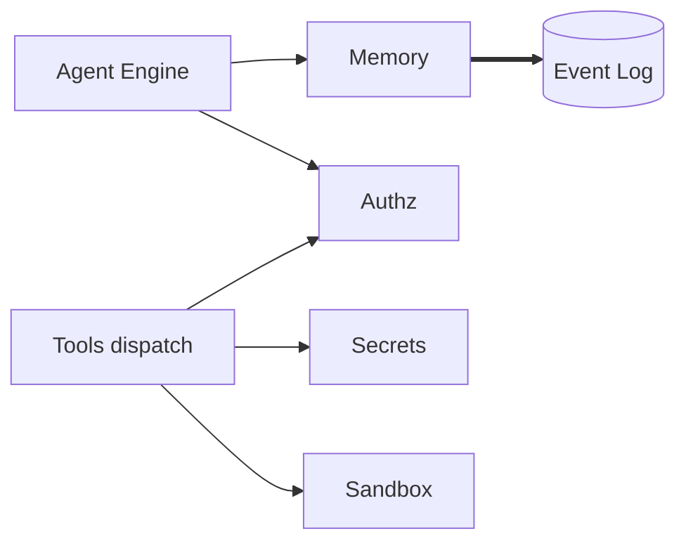

# Providers

Four parts of the platform are swappable: memory, secrets, sandbox,
and authorization. Each sits behind a Python protocol; each has a
default implementation that ships with Kolsch and a path to drop in
something else.



The Agent Engine reads memory and runs authz checks per exchange. The
Tools dispatch resolves secrets before a tool body runs and routes
sandboxed work through the sandbox provider.

## Memory

`MemoryContext` is the protocol — a session-bound handle the Agent
Engine uses for memory reads, writes, and queries.
`RecentBufferMemoryProvider` is the implementation that ships today;
it exposes a fixed-size window over the most recent events on the
thread. Custom providers (semantic, vector-backed) implement the
protocol and slot in by configuration.

Memory writes are events: every `memory.written` and
`memory.deleted` lands on the log so the in-memory cache is
reconstructable on restart.

## Secrets

`SecretsProvider` resolves the names a tool declared in
`secrets_needed=` into actual values. `DotenvSecretsProvider` is
the implementation that ships today; it reads from `.env` in the
workspace root. Tools never reach for env vars themselves; the
dispatch hands them a `ToolContext.secrets` dict already populated.

## Sandbox

`SandboxProvider` is the protocol meant to isolate untrusted code.
The `native` variant that ships today is a pass-through — it runs
the work in the calling process with no isolation. Real isolation
(subprocess limits, container-backed execution) is a planned future
variant. Tools that shell out (`bash`, the workflow `bash` runner)
still go through the sandbox so the integration point is in place
when a real implementation lands.

## Authorization

`AuthorizationProvider` decides whether a tool call is allowed. The
current implementation is rule-based — a list of records compiled
into a fast matcher. Each rule has three fields:

| Field | Type | Semantics |
|---|---|---|
| `what` | `str` | The tool's fully-qualified ref (`kolsch/bash`), a system action namespace (`agent.execute.*`), or `*` for any. |
| `pattern` | `str` | A glob matched against the target — for `kolsch/bash` the target is the command string, for `kolsch/read_file` it's the path, etc. Defaults to `*`. |
| `effect` | `"allow" \| "deny" \| "prompt"` | The decision, or a prompt to the user. |

A concrete rule set:

```yaml
authorization:
  variant: rule_based
  config:
    rules:
      # Allow the agent to read anything under the workspace
      - what: kolsch/read_file
        pattern: "workspace:**"
        effect: allow

      # Allow git commands but nothing else that shells out
      - what: kolsch/bash
        pattern: "git *"
        effect: allow

      # Prompt on any other bash — surfaces the four-choice modal
      - what: kolsch/bash
        pattern: "*"
        effect: prompt

      # Hard-deny writes to .env
      - what: kolsch/write_file
        pattern: "**.env"
        effect: deny
```

A `prompt` effect surfaces the call to the user in `kolsch chat`
with four choices: **allow once**, **allow always** (writes a new
`allow` rule and remembers), **deny once**, **deny always** (writes
a new `deny` rule and remembers).

Rules live in three layers: each agent's `permissions:` block, each
bundle's `bundle.yaml` `permissions:` block, and the platform-wide
`platform.yaml` `authorization.config.rules`. The authz provider
walks them first-match-wins in that order — agent first, then
bundle, then platform, then default-deny. Because matching stops at
the first rule that fires, an agent or bundle `allow` rule can
grant access the platform layer would have denied. The layering is
precedence, not enforced narrowing: nothing in the code stops a
bundle from effectively widening the platform policy. Workspace
owners installing untrusted bundles have to audit each bundle's
`permissions:` block themselves.

## Principles

**Protocols, not base classes.** Each provider is a Python
`Protocol`. Anyone can implement one without subclassing or
importing from `providers/`. Test fakes and production
implementations sit at the same level.

**Defaults work without configuration.** A fresh workspace runs
with the shipped implementations of all four providers and never
has to configure them. Swapping in custom ones is a per-workspace
decision.

**Provider state is reconstructable.** Memory writes are events,
authz decisions are events. Restarting a process and replaying the
log produces the same memory and the same authz outcome.

**Each provider knows only its own concern.** Memory doesn't know
about secrets, secrets doesn't know about authz, authz doesn't know
about sandboxing. The Agent Engine wires them together; the
providers don't talk to each other directly.

---

The class reference is at [API: Providers](../api/index.md#providers).
The [Memory provider contract](../explanation/memory-provider-contract.md)
covers the memory protocol in detail. The [Secrets / Sandbox / Authz
contract](../explanation/secrets-sandbox-authz-contract.md) covers
the other three.
