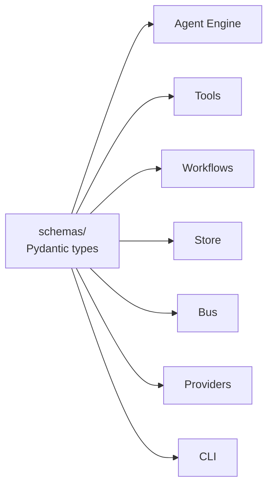

# Schemas

Schemas is the shared types package. Identifiers, entity records,
events, and the resolved agent configuration all live here so every
subsystem speaks the same vocabulary.

Schemas has no dependencies on other subsystems — it sits at the
bottom of the stack. Every subsystem that produces or consumes a
cross-module type imports from here. Putting them in one place keeps
the store, the bus, the engine, and the tools from needing to import
from each other through type plumbing.

## Types

`PrefixedId` is the base class for every identifier. A prefixed id is
a `str` subclass with a structural prefix — `ses_<uuid>` for
sessions, `th_<uuid>` for threads, `ev_<uuid>` for events, and so on.
Pydantic validates them on assignment.

`Session`, `Thread`, and `Actor` are the entity records. Sessions
hold UI-organisational state (name, starred, archived); threads
hold the conversation persistence. `Actor` is inline on every event
— a small record (`kind`, `id`) that names who produced the event
(`system`, `agent`, `user`). It's not a foreign key; it travels with
the event itself.

`Event` is the wrapper around a log record. It carries the
identifiers, the type tag, the actor, the timestamp, and a typed
`data` payload. Each of the 18 event types has a dedicated `*Data`
Pydantic model; the full list lives in the
[schemas reference](../reference/schemas.md).

`ResolvedAgentConfig` is what the Agent Engine receives. It carries the
model spec, the prompt, the I/O spec, the runtime knobs, and the
references to tools, skills, and context files the agent uses.

## Principles

**One vocabulary, one home.** Identifiers, entity records, and the
event envelope live in `schemas/`. Subsystems that produce or
consume them import from there. No subsystem defines its own
identifier or its own envelope.

**Prefixed ids are real `str` values.** They subclass `str` so they
JSON-serialise without wrappers, work as dict keys, and pass
`isinstance(x, str)`. Pydantic still runs the prefix and body checks
at validation time.

**Events are permissive on the outer wrapper, strict on the
payload.** The `Event.data` field is `dict[str, Any]` so the on-disk
JSONL stays forward-compatible — an older reader can still parse a
newer event by ignoring fields it doesn't know. Callers that want
strict validation construct the matching `*Data` model and pass
`.model_dump()` into the wrapper.

**No upward imports from schemas.** Schemas does not import from any
other subsystem at module scope. Where types from upper layers are
referenced (e.g. `TraceId` on `Event`), they're typed loosely
(`str | None`) to avoid the import cycle that would block schemas
from loading first.

---

The class reference is at
[Schemas reference](../reference/schemas.md) — the field-level
listing is generated from source docstrings and stays in sync with
the code.
