# Skills

A skill is a packaged capability the agent can load on demand. Each
skill is a directory containing a `SKILL.md` file with frontmatter
plus a body, and any supporting files (scripts, prompts, reference
data) the skill needs. The agent's system prompt sees a catalog of
available skills — name and description only — and the model decides
when to read the full `SKILL.md` body through the regular `read`
tool.

This follows the [Anthropic skills](https://docs.anthropic.com/en/docs/agents/skills)
model: skills aren't inlined into the prompt up-front. They're
discoverable summaries; the body loads into the model's context
only when the model (or the user, via force-invoke) decides to use
it. The same `tool.read` event records that load — there's no
parallel "skill loaded" event type.

```mermaid
graph LR
    SkillDir[bundles/.../skills/&lt;name&gt;/<br/>SKILL.md + files] --> Catalog[Asset Catalog]
    Catalog --> SkillsSubsystem
    SkillsSubsystem --> Listing[Skills listing<br/>name + description]
    Listing --> Prompt[Agent prompt<br/>via &#123;&#123; skills &#125;&#125;]
    Prompt --> Model
    Model -->|decides to load| ReadTool[read tool]
    ReadTool --> SkillDir

    click Catalog "../assets/"
    click ReadTool "../tools/"
    click Prompt "../templating/"
```

Force-invoke flips the trigger: when a user pins a skill for a turn,
the engine emits a synthetic `tool.called` for `read` on the skill's
`SKILL.md` path. The body lands in the model's context as a
`tool.result` event, the same shape it would have if the model had
asked for it. Authorization runs through the regular `tool.read`
check — there's no skill-specific authz action.

## Types

`EnabledSkill` is the engine-side record returned by
`SkillsSubsystem.get_enabled_skills`. Its fields:

- `ref` — the 3-segment catalog reference (`kolsch/skills/code-review`).
- `name`, `description` — surfaced to the model in the system-prompt
  listing.
- `license`, `compatibility` — optional metadata from the frontmatter.
- `allowed_tools` — the list of tools the skill can call when active.
  Constrains the model's tool surface for the duration of the skill.
- `disable_model_invocation` — when `true`, the skill is omitted from
  the system-prompt listing; only force-invoke can route to it. Used
  for skills the agent's author wants reachable only via user pin.
- `metadata` — author-supplied dict for additional fields.

`SkillInvocation` is the handoff record for force-invoke. It holds
the ref and the absolute `SKILL.md` path the engine passes to the
synthetic `read` call.

`SkillsSubsystem` is the entry point. Its public methods are
`get_enabled_skills(config)` (resolves the agent's `skills.config.enabled`
list against the catalog) and `force_invoke(skill_ref, config)`
(verifies the ref is enabled, then resolves the on-disk path for the
synthetic read).

`SkillItem` (lives under `templating/vars/skills.py`) is the Jinja
view a prompt template sees — name, description, and ref only. The
body is intentionally absent from this scope, because the body lives
in `SKILL.md` and the model reads it via tool dispatch when needed,
not by template rendering.

## Principles

**Skill bodies aren't pre-loaded into prompts.** The agent's system
prompt sees the listing — name and description per skill. The model
chooses when to load a body via the `read` tool. This keeps the
prompt small even when an agent has many skills enabled, and it
means a skill the model never invokes never costs context tokens.

**Force-invoke is a synthetic read, not a separate code path.** When
the user pins a skill, the engine synthesises a tool call to `read` on the
SKILL.md path. The result event has the same shape as any other
tool result. Authz runs the regular `tool.read` check; there's no
"is this user allowed to force-invoke" predicate the engine has to
maintain.

**`allowed_tools` narrows the tool surface while the skill is
active.** If a skill declares `allowed_tools: [grep, find]`, the
agent can only call `grep` and `find` while operating in that
skill's context. This prevents a skill from quietly granting itself
broader tool access than its author intended.

**`disable_model_invocation` hides without disabling.** A skill with
this flag set is omitted from the system-prompt listing, so the
model can't discover it. Force-invoke still works — useful when the
agent author wants a skill reachable only by user pin (an emergency
operation, a destructive cleanup).

**No skill-specific events.** Every skill load is a `tool.called` →
`tool.result` pair on `read`. Cross-JSONL forensics tools that
already understand tool events automatically understand skill
loads.

---

The class reference is at [API: Skills](../api/index.md#skills).
The [Skills subsystem contract](../explanation/skills-subsystem.md)
covers the SKILL.md frontmatter schema, the force-invoke handshake,
and the catalog-build validation rules.

!!! note "Possible follow-up"
    The conceptual fit between Kolsch skills and the broader
    Anthropic skills model needs more thought — particularly around
    skill discovery (when should the model proactively check a
    skill?), parameter passing into force-invoke, and how skills
    compose with workflow node graphs. A QoL spec capturing the
    design questions is likely warranted before scaling the skill
    catalog.
