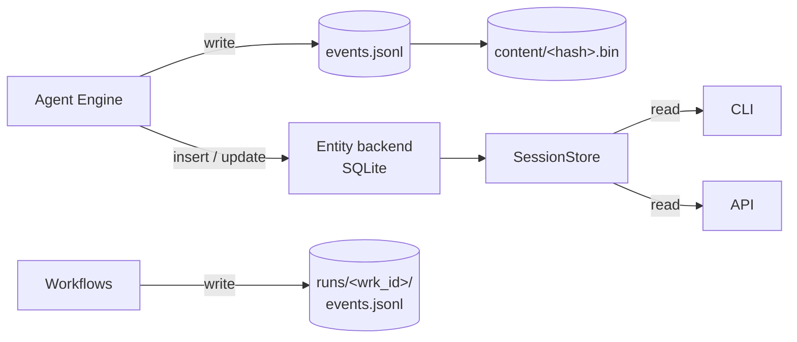

# Store

The Store is the persistence layer. Every event the system produces
is written to a JSONL file on disk; entity records (sessions,
threads, actors) sit in a SQLite table next to the log. The JSONL is
the source of truth — entity records and in-memory caches can both
be rebuilt from it.

Each session has its own `events.jsonl`. Each workflow run has its
own `runs/<wrk_id>/events.jsonl`. Oversized payloads (large model
responses, big tool outputs) get written to a separate file named
by their content hash (`content/<sha256>.bin`); the event in the
JSONL keeps a truncated preview and a pointer to that file.

Reads come back through the same `SessionStore` — the CLI's `kolsch
sessions list`, the API's `GET /sessions`, and the chat surface's
session resume all go through it.

## Types

`SessionStore` is the public entry point. It opens and reads JSONL
files, tracks the most recent event id per thread (so each new
event can point at it as its parent), and routes entity-record
operations through the configured backend.

`EntityBackend` is the protocol for the storage backend.
`SqliteBackend` is the only shipping implementation today. The
protocol exists so a Postgres backend (or another external store)
can drop in later without changing `SessionStore` — that work
hasn't started.

The JSONL surface lives as module-level functions in `store/jsonl.py`:
`append_event_sync(*, root, session_id, thread_id, event)` writes
one line and inlines the fsync for critical event types,
`read_lines(path)` streams the file back, and
`recover_partial_final_line(path)` repairs the tail if a crash left a
half-written record. There's no `Writer` class — the per-session
`flock` and the leaf-cursor computation live inside
`append_event_sync` itself. `SessionStore.append_event` delegates to
it through a worker thread.

`ContentRef` is the inline pointer to the sidecar file. When a
payload is larger than the inline threshold, the JSONL keeps the
truncated form plus the `ContentRef`, and the full payload lives at
`content/<hash>.bin`.

## How it works

**The JSONL is ground truth.** No state lives outside what the log
can rebuild. Memory caches, entity rows, and replay output all
derive from it. The log is the only thing that has to survive a
crash; everything else can be regenerated.

**Append-only.** Events are never modified or deleted after they
land. Corrections are new events that supersede prior ones; the
history stays intact. This is what makes replay work — if the log
could be edited, two replays could produce different results.

**Entity records are redundant copies kept for fast lookups.** The
`sessions` and `threads` tables exist so `list sessions by recency`
doesn't have to scan every JSONL file. They're built from the log
and updated as new events land; losing them is recoverable.

**Oversized payloads spill to a sidecar file.** The inline JSONL
stays small even when an agent returns a 5 MB response. Large blobs
go to `content/<hash>.bin` and the event carries a truncated preview
plus the hash. Anyone reading the event can fetch the full payload
on demand; the common path (scrolling chat history, replay) reads
only the JSONL.

**Critical events fsync.** Events whose loss would corrupt the
model's view of history call `fsync` before returning — currently
`agent.message`, `tool.result`, `tool.failed`, `model.response`,
`config.set`, `session.opened`, `thread.exchange_completed`, and
`thread.exchange_failed`. Diagnostic events batch and flush later.
After a crash, recovery never sees a half-written critical event.

---

The class reference is at [API: Store](../api/index.md#store).
The [Session / Run Store contract](../explanation/session-run-store-contract.md)
covers the JSONL schema, the entity-table shape, and the fsync
policy in detail.
