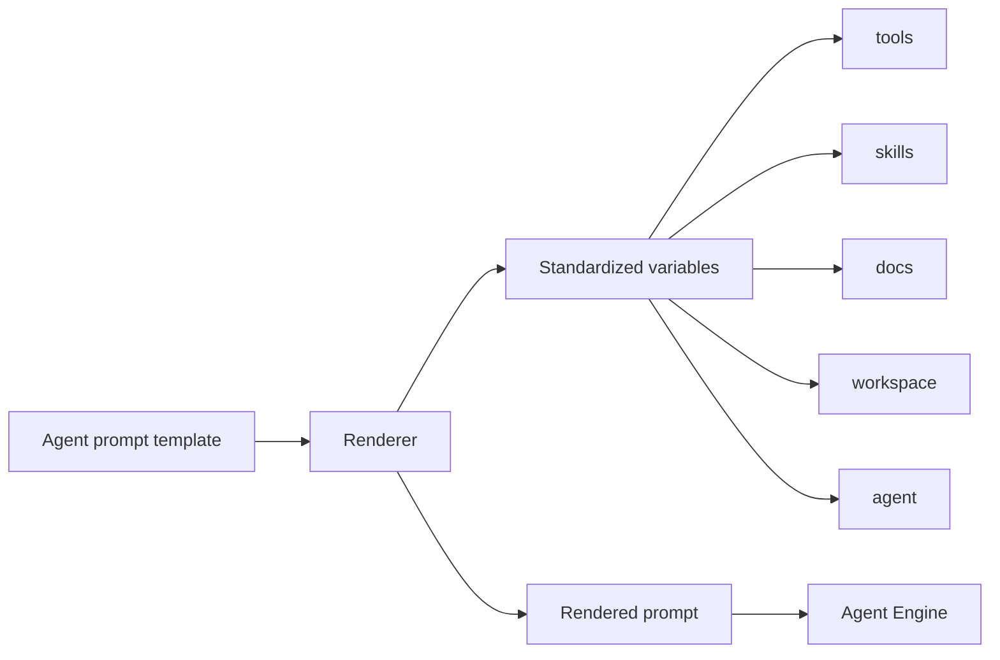

# Templating

Agent prompts are Jinja2 templates. Templating wires up the rendering
environment, defines the five standardized variables every prompt
can use, and resolves context files referenced in the YAML.

When the Agent Engine loads an agent, the templating layer renders its
prompt against a context object populated by each subsystem. A prompt
that doesn't use any Jinja syntax renders byte-identically to itself
— authors who don't want templating don't have to think about it.

## Types

`render_prompt(template_string, context, *, template_name)` is the
top-level entry point. It takes a prompt template (one of the agent
YAML's prompt layers, or the whole inline prompt) and the rendering
context, and returns the rendered string the engine sends to the
LLM.

The Jinja environment runs in Jinja's `StrictUndefined` mode, so a
typo in a variable name fails at render time with a clear error
instead of silently rendering an empty string.

The standardized variables — six of them — split into two shapes:

**List-shaped** (each supports `.list()`, `.summary()`, `.names()`,
`.get(name)`, `.count`):

- `tools` — the tools the agent has access to.
- `skills` — the agent's enabled skills.
- `docs` — workspace documents the agent should know about.

**Single-object** (named fields, no method family):

- `workspace` — `path`, `summary`, `allowed_paths`, `denied_paths`.
- `agent` — `name`, `id`, `model`, `tools`, `permissions`,
  `context_files`.
- `platform` — non-sensitive `platform.yaml` values (provider list,
  defaults, authz rules). Secrets never reach this scope.

Each variable lives under `templating/vars/`. The list-shaped ones
are plain classes with `__slots__`; the single-object ones and the
item types are dataclasses.

## Principles

**Typos in variables fail at render time, not at first model call.**
Jinja's `StrictUndefined` mode raises a clear error when a template
references an undefined variable. A misspelled `{{ tooles }}` fails
during agent-load with a pointer to the file and line, rather than
silently rendering empty and producing a confused model response.

**One API across all variables.** The `.list()`/`.summary()`/
`.names()`/`.get()`/`.count` family works the same way on every
top-level variable. A prompt author learns one pattern and applies
it everywhere.

**Plain-text prompts render byte-identically.** A prompt with no
`{{` or `{%` round-trips through Jinja unchanged. The templating
layer is transparent when the author doesn't engage with it.

**Secrets never reach the prompt scope.** The `platform` variable
exposes the public `platform.yaml` fields only. API keys, tokens,
and connector secrets live in `.env` and are routed through the
Secrets provider, never through the templating context.

---

The class reference is at [API: Templating](../api/index.md#templating).
The [Jinja extensions reference](../explanation/jinja-extensions.md)
covers the variable APIs in detail and the context-file resolution
flow.
