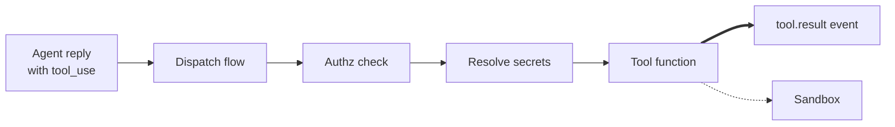

# Tools

Tools are the Python functions agents call to do work in the world —
running a bash command, reading a file, calling an HTTP API. The
Tools subsystem holds the `@tool` decorator that marks a function as
a tool, the registry that tracks which tools an agent has, and the
dispatch flow that runs a tool call when an agent asks for one.

The **dispatch flow** is the fixed sequence every tool call goes
through: validate the arguments against the tool's Pydantic schema,
run an authorization check, resolve any secrets the tool needs,
wrap the call in the sandbox provider, run the tool function, and
write a `tool.result` (or `tool.failed`) event.

When the LLM emits a tool-use request, the Agent Engine hands it to the
Tools subsystem. Dispatch runs the steps above and writes the result
back as an event the framework feeds into the next model call.

## Types

`@tool` is the decorator that marks a coroutine function as a tool.
It takes a name, a description, and a Pydantic `args_schema`, and
optionally `secrets_needed` (a list of secret names the dispatch
should resolve), `action` (an override for the authz action string),
`timeout_seconds` (per-call timeout), and `summary` (a one-line
prompt-listing description that falls back to the first sentence of
`description`).

`ToolDefinition` is the dataclass the decorator stamps on the
function as `_tool_definition`. The Tools subsystem discovers tools
by reading this attribute.

`ToolContext` is the runtime context passed to every tool function.
It carries the agent, session, and thread ids, the principal
performing the call (the authenticated identity the check ran
under), the resolved secrets, the workspace root, the path policy,
the per-call id, and the cancellation token.

`ToolsSubsystem` is the public entry point. It scans the catalog for
tool definitions, binds the per-agent set (each agent declares its
tools in its YAML's `tools:` block; the subsystem looks those up and
makes only those available for that agent's calls), and exposes the
dispatch entry point.

## Principles

**Tools are plain Python functions.** No framework, no decoration
beyond `@tool`, no inheritance. A tool author writes a coroutine
that takes typed arguments and returns a typed result.

**Authorization runs before the body.** Every tool call passes
through the authz provider before the function runs. If the rule
matches with `effect: prompt`, the user sees a four-choice approval
modal in chat (allow once, allow always, deny once, deny always)
and the dispatch waits for the answer. If the call is denied — by
rule or by user choice — the dispatch writes a `tool.failed` event
with `recovery_hint` containing the `/perm allow ...` command the
user can type to unblock it.

**Builtin tools ship as bundle files.** The starter bundle
installed by `kolsch setup` lays `kolsch/bash`, `kolsch/read_file`,
`kolsch/write_file`, `kolsch/list_files`, and others into
`<workspace>/bundles/kolsch/tools/` as plain Python files. Users can
read them, copy them as templates, or replace them. (The Tools
subsystem also keeps engine-side factories — `make_bash`,
`make_read_file`, etc. in `tools/builtins.py` — that build the same
tools without a bundle file. Tests use these directly so they don't
need a starter bundle on disk; the engine prefers the bundle file
when one exists.)

**Only the dispatch writes tool-call events.** Tools never write
`tool.called` / `tool.result` / `tool.failed` events themselves.
Dispatch owns the event sequence so the log stays a faithful record
of what happened — a tool that wrote its own events could lie about
the result, skip the authz event, or drop the secrets-resolved
marker. Dispatch records the full chain or none of it.

**Secrets are resolved in the dispatch, not by the tool.** Tools
declare what secret names they need (`secrets_needed=["GITHUB_TOKEN"]`);
dispatch reads them through the Secrets provider before the body
runs. Tools never touch env vars or file paths — moving secret
resolution into the tool would let a buggy tool log its own secrets
to the event log.

**An external harness can drive tools through the same guarantees.**
When a `SubprocessAgentFramework` agent runs (e.g. Claude Code), the
harness reaches kolsch tools over the **MCP tool bridge**
(`tools.bridge.ToolBridgeServer`, exposed by `kolsch mcp bridge`). Each
bridged call still routes through the governed path — authz, secrets,
event recording — via the shared **observed invocation core**
(`tools.observed.invoke_observed`, whose `Ok` / `Denied` / `Failed`
outcomes both the in-process dispatch and the bridge consume). The
bridge is a transport, not a bypass: a tool called from an external
harness is logged and gated exactly like one called in-process.

---

The class reference is at [API: Tools](../api/index.md#tools).
The [Tools subsystem contract](../explanation/tools-subsystem.md)
covers the discovery rules, the bundle-namespacing guarantee, and
the per-agent registry shape.
