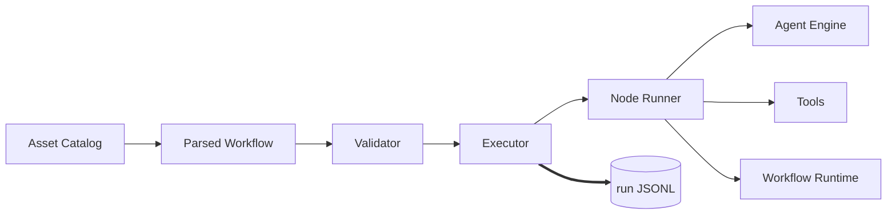

# Workflows

The Workflow Runtime is Kolsch's DAG-based pipeline system for
orchestrating tasks and agents. A workflow is a YAML file that
declares a graph of nodes connected by edges; the runtime picks
each node when its predecessors are done and runs it through the
matching runner.

The design center is similar to **CrewAI** (agent crews with
sequential or hierarchical processes) and **n8n** (visual DAG-based
automation): a graph of steps, each step doing one bounded thing,
data flowing along the edges. What Kolsch does differently:

- **YAML-native.** Workflows are text files a person or a script
  can generate. No visual builder, no GUI runtime.
- **Python-native for authored nodes.** Custom nodes are `@node`-
  decorated Python functions with typed `Inputs` and `Outputs`
  Pydantic models. Author your own; register them in a bundle.
- **Agents are first-class.** An `agent` node invokes a catalogued
  Kolsch agent — its own YAML config, its own tools, its own
  prompt — rather than treating agent invocation as an external
  API call.
- **Local-first, event-sourced.** Every run writes to
  `runs/<wrk_id>/events.jsonl`. Cancel, pause, resume, and fork
  all read from that log — no external orchestration engine to
  stand up.

Workflows are catalogued assets, discovered the same way tools,
skills, and agents are. A file at
`bundles/<bundle>/workflows/<name>.yaml` is addressable as
`<bundle>/workflow/<name>` and shows up in `kolsch workflows`.



## Workflow YAML

A workflow file has a small top-level shape:

```yaml
description: "Sanity-check pipeline."
extends: []                       # Parent workflow refs, if any
policy: []                        # Authz rules for this workflow
timeout_seconds: 60               # Whole-run timeout
concurrency: sequential           # or "auto" for parallel branches

nodes:
  start:
    type: kolsch/nodes/noop
    description: "structural root"
  probe:
    type: kolsch/nodes/bash
    command: "echo {{ inputs.msg }}"
    timeout_seconds: 10           # Per-node modifiers
    when: "{{ inputs.msg is defined }}"
    retry: 0
    secrets: []

graph:
  edges:
    - from: start
      to: probe
      binds:
        msg: "hello"              # Inputs supplied to probe
      when: true
```

**`nodes:`** is a map of node name → node definition. Each node
dispatches on `type:` to a specific runner. **`graph.edges:`**
declares the dependencies — an edge from `A` to `B` means `B` can
only run once `A` is done. **`binds:`** on an edge is how upstream
outputs become downstream inputs. **`when:`** is a Jinja expression
gating whether the node or edge fires.

A workflow with `graph:` is a runnable pipeline. A workflow without
`graph:` is a **node library** — a set of reusable nodes another
workflow can `copy_of:` or reference.

## Node types

Fifteen built-in node types ship with the platform, each
registered at `kolsch/nodes/<name>`:

- `bash` — run a shell command. Branchable on exit code.
- `noop` — placeholder for structural fan-in / fan-out.
- `user_input` — pause the run and wait for an operator response.
- `set_state`, `delete_state` — mutate the workflow's run-scoped
  state dict.
- `branch` — evaluate a boolean; drives which outgoing edge fires.
- `filter` — reduce a list by a predicate.
- `compute` — evaluate a Jinja expression and capture the value.
- `map` — fan out over a list, calling an `apply:` worker per item.
  Sequential by default; `parallel: true` runs items concurrently
  under an optional semaphore.
- `read_file`, `write_file`, `list_files` — file-IO wrappers over
  the corresponding tools.
- `browse_url` — fetch a rendered web page via the `browse_url`
  tool (opt-in `kolsch[browse]` extra: Playwright + Chromium).
- `agent` — invoke a catalogued Kolsch agent through the Agent Engine.
- `workflow` — spawn a sub-workflow (nested runs share the trace
  id; depth is capped at 16).

Beyond the built-ins, any bundle can register its own node types.
An authored node is a `@node`-decorated Python function with typed
`Inputs(BaseModel)` and a return annotation of `BaseModel | bool |
tuple[bool, BaseModel]`. The parser dispatches unknown `type:` refs
to `CatalogNodeRunner`, which resolves them through the asset
catalog. Because authored nodes are Python, workflows can contain
real code — the YAML declares *what* runs; the Python inside a
node does the work. See the
[Write a workflow node](../how-to/write-a-workflow-node.md) guide
for the full authoring contract, and the
[workflow YAML reference](../reference/workflow-yaml.md) for every
field on every node type.

`retry:` and `timeout:` are per-node modifiers, not node types.
They wrap any runner (`with_retry`, `with_timeout`) at dispatch
time. `retry` wraps first so the timeout deadline bounds the whole
retry budget.

## DAG semantics

When a run starts, the Executor computes the topology once (Kahn's
algorithm) and doesn't re-sort. The `concurrency:` field on the
workflow picks the walk mode.

### `sequential` (default)

Walk the sorted topology top-to-bottom. For each node:

1. Skip if already decided.
2. Skip if any predecessor isn't completed.
3. Evaluate its `when:` gate. If false, mark it skipped.
4. Render its `binds:` from upstream outputs.
5. Dispatch its runner.
6. Capture the output.
7. Prune descendants of branches that weren't taken.

One node in flight at a time. Two runs of the same workflow on the
same inputs produce identical event sequences — replay is
deterministic.

### `auto`

Repeatedly compute the **ready set** (predecessors decided, not
in-flight, not pruned) and dispatch every node in it concurrently:

1. Find the ready set.
2. Dispatch each ready node as an asyncio task.
3. Wait for the first to finish (`asyncio.wait(FIRST_COMPLETED)`).
4. If it failed, cancel its siblings with
   `reason: sibling_failure`.
5. Re-scan. Repeat until no nodes remain.

`set_state` and `delete_state` serialise on a shared mutation lock.
Sibling branches running in parallel may not have overlapping state
read/write sets — the validator checks this at load time so runtime
races are impossible.

### Sub-workflows

A `workflow` node builds a fresh Executor for the child run. Python
never recurses — the 16-deep cap is a data check on
`ctx.call_chain`, not a stack check. Parent and child run
independently, each with its own JSONL, joined only by the shared
`trace_id`.

**The child surfaces in the chat TUI as its own flat peer card**
(spec-103). The parent Executor's `event_observer` and
`sub_agent_event_observer` are threaded into the child Executor via
`NodeContext` fields (populated in `_build_ctx`, forwarded by
`WorkflowSubRunner`), so the child's `run.started` / `node.*` /
`run.completed` events — and every child `agent` node's sub-agent
messages + tool calls — reach the same observer channel as the
parent's. On the parent-side `workflow.node.called_workflow` event,
`WorkflowsImpl` opens a second workflow card, registers a child run
record (with `parent_run_id` set), and drains the child's events onto
that card. The child renders through the same `WorkflowRenderer` as a
top-level run, laid out as a flat PEER (never nested inside the
parent's node row — the r4 flat-cards invariant keeps indentation
bounded as sub-workflows nest) with a `↳ from <parent-ref>`
breadcrumb. Each nested level (grandchild and deeper) gets its own
peer card the same way. The forward navigable link from the parent's
`workflow`-node row to the child card is a separate concern
(feat-104); this surface makes the child visible and drill-in-able.

## Validation

The validator runs nine layers when a workflow loads. It
accumulates findings within a layer rather than short-circuiting,
so authors see all the problems at once:

1. **Extends policy.** Extended workflows may not carry their own
   `policy:` block (would silently mask the parent's).
2. **Structural.** Every `edge.from` / `edge.to` / `copy_of:` /
   `map.apply:` names a real node. Every non-map-worker node is
   reachable from a start. No bind-key collisions across
   multi-input edges. No unreachable nodes.
3. **Branching.** `branch:` edges only fire off branchable sources
   (`bash`, `branch` node, or authored `@node` returning
   `bool` / `tuple[bool, BaseModel]`). A `branch` node must wire
   both true and false arms.
4. **Jinja refs.** A Jinja AST walk of every string in the
   workflow checks that `nodes.<X>.<Y>` references name a defined
   node, that the referenced node is a transitive predecessor, that
   map workers aren't referenced from outside, and that closed
   output schemas expose the field being read.
5. **Type-specific.** Per-node-type Pydantic validation via the
   parser.
6. **Catalog node defs.** For authored `@node` modules: catalog
   resolution, import success, top-level `run`, correct signature
   and return annotation.
7. **Authz.** Strict `from:` validation on `policy:` rules via the
   authz provider's compile path.
8. **Timeouts.** Positive integers on workflow and node scope; a
   warning when a node's timeout exceeds the workflow's.
9. **Concurrency.** Parallel map workers may not transitively
   write state. In `auto` mode, sibling parallel branches may not
   have overlapping state read/write sets.

Cycle detection sits upstream of these — the parser produces a
`graph.edges` list plus a `nodes` dict, so Kahn's topology walk
can't stall on a cycle (a cycle surfaces as an unreachable node
in Layer 2).

## Principles

**Every node writes lifecycle events.** A runner writes
`workflow.node.started` when it begins and one of
`workflow.node.completed`, `workflow.node.failed`,
`workflow.node.timed_out`, or `workflow.node.pruned` when it
finishes. Side events along the way — `workflow.node.logged`,
`workflow.node.emitted`, `workflow.node.called_workflow`,
`workflow.node.called_workflow_completed` — record intermediate
work. A replay rebuilds the full execution from these events
alone.

**Sub-workflows produce their own JSONL.** When a `workflow` node
runs another workflow, the child run gets its own
`runs/<wrk_id>/events.jsonl`. Cross-JSONL forensics follows the
parent pointer; the child and parent stay independently replayable.
For the LIVE chat surface the child does not rely on tailing that
JSONL — the parent's observers are threaded into the child Executor so
the child's events (including session-scoped sub-agent detail, which
is never written to the workflow JSONL) stream straight onto the
child's own peer card (see [Sub-workflows](#sub-workflows) above).

**Pause is a first-class terminal state.** A `user_input` node
raises `WorkflowPausedForInput`, the Executor writes a `waiting_at`
sidecar, flips the run status to `waiting_for_input`, and exits
cleanly. `kolsch workflows resume <run>` (or the API's resume
endpoint) replays the JSONL, validates the operator response,
writes the `workflow.run.resumed` and paused-node
`workflow.node.completed` events, and re-enters the walk loop.

**Cancellation is cooperative across the whole run.** The Executor
polls the cancellation token between nodes; each runner polls
during its work; concurrent runs poll at each `asyncio.wait`
boundary. Nothing kills a node mid-flight — a `bash` that's
already half-run runs to completion; a `write_file` mid-write
finishes its write. This preserves the "the log always describes
what actually happened" property.

**Resume re-runs the last open node.** On startup the Executor
reads the JSONL, finds the most recent `workflow.node.started`
without a matching terminal event, and runs that node again from
scratch. Nodes with external side effects (`bash`, `write_file`)
are the author's responsibility to make safe to retry; pure nodes
(`compute`, `branch`, `filter`, `noop`) are idempotent by
construction.

## Types

`Workflow` is the parsed YAML — the top-level Pydantic model with
`description`, `extends`, `policy`, `timeout_seconds`,
`concurrency`, `nodes`, and `graph`. The parser dispatches each
node definition to its per-type Pydantic model
(`BashNodeDef`, `AgentNodeDef`, `MapNodeDef`, `BranchNodeDef`,
`CatalogNodeDef`, `CopyOfNodeDef`, etc.) with `extra="forbid"` so
misspelled fields fail loudly.

`IterativeExecutor` walks the graph. It computes topology once,
picks ready nodes, dispatches their runners, captures outputs,
prunes non-taken branches, and writes the lifecycle events.

`NodeContext` is the runtime handle a runner receives. It carries
the run identifiers, the workspace root, the workflow inputs, hooks
for rendering Jinja and writing events, and ids that tie events
from this run to the parent run when this workflow was spawned by
another.

`WorkflowRun` is the persisted record of one execution. It holds
the status (`pending`, `running`, `waiting_for_input`, `succeeded`,
`failed`, `timed_out`, `aborted`), the workflow ref, the inputs,
the trace id, and parent / fork pointers.

---

The class reference is at [API: Workflows](../api/index.md#workflows).
[Workflow foundation](../explanation/workflow-foundation.md) covers
the data model. [Workflow event log](../explanation/workflow-event-log.md)
covers the JSONL shape. [Workflow policy model](../explanation/workflow-policy-model.md)
covers branch and retry semantics.
