# Chat color guide

The semantic color palette for the chat TUI, its usage rules, and the
`NO_COLOR` (mono) strategy. This page **documents current conventions and
flags inconsistencies** as a backlog for a later normalization pass — it
does not change any CSS.

The renders on this page are real widget captures produced by the
[widget capture harness](#regenerating-the-gallery). For the spacing,
glyph, and border conventions see the
[chat styleguide](chat-styleguide.md).

!!! tip "Redundant carriers — the accessibility rule"
    Every semantic distinction in the chat surface is carried by **at
    least two** of hue, glyph, and text-style. A user in `NO_COLOR`, on a
    grey-scale terminal, or with a colour-vision difference still reads
    every state from either the glyph or the text-style — never from hue
    alone. See §"[NO_COLOR / mono strategy](#no_color-mono-strategy)"
    for the per-role mapping, and `NoticeWidget` (below) as the canonical
    example: `ℹ` / `⚠` / `✗` prefix every notice, in both colour and
    mono modes, regardless of the amber/red hue overlay.

!!! note "Source of truth"
    The palette lives in `src/cli/chat/themes/theme.tcss` (color) and
    `src/cli/chat/themes/mono.tcss` (`NO_COLOR`). Theme selection is by
    environment: `_resolve_css_path()` in `src/cli/chat/app.py:157` loads
    `mono.tcss` when `NO_COLOR` is set, else `theme.tcss`.

## Palette

Seven semantic variables carry every intentional hue. Widgets reference the
variable, not the hex, so a future theme is one more `.tcss` file.

<div class="chat-swatch" markdown>

| Var | Swatch | Hex | Semantic | Mono |
|---|---|---|---|---|
| `$user-border` | <span style="display:inline-block;width:1.1em;height:1.1em;border:1px solid #888;background:#2ea043"></span> | `#2ea043` | user turn frame (GitHub green) | `ansi_default` |
| `$assistant-fg` | <span style="display:inline-block;width:1.1em;height:1.1em;border:1px solid #888;background:#b0c0d5"></span> | `#b0c0d5` | assistant prose / frame (soft blue-grey) | `ansi_default` |
| `$tool-fg` | <span style="display:inline-block;width:1.1em;height:1.1em;border:1px solid #888;background:#4dd0e1"></span> | `#4dd0e1` | tool calls, done states, compaction (cyan-400) | `ansi_default` |
| `$error` | <span style="display:inline-block;width:1.1em;height:1.1em;border:1px solid #888;background:#ff5555"></span> | `#ff5555` | error / failed | `ansi_default` |
| `$warning` | <span style="display:inline-block;width:1.1em;height:1.1em;border:1px solid #888;background:#ffb454"></span> | `#ffb454` | warning / paused / awaiting approval | `ansi_default` |
| `$hint` | <span style="display:inline-block;width:1.1em;height:1.1em;border:1px solid #888;background:#6e7681"></span> | `#6e7681` | hints / disabled / low-emphasis | `ansi_default` |
| `$chat-surface` | <span style="display:inline-block;width:1.1em;height:1.1em;border:1px solid #888;background:#1a1d24"></span> | `#1a1d24` | inset background (info bar, slash popup) | `ansi_default` |

</div>

Declared in `theme.tcss`: `$user-border` L23, `$assistant-fg` L24,
`$tool-fg` L25, `$error` L28, `$warning` L29, `$hint` L30, `$chat-surface`
L38. The `mono.tcss` mapping (all seven → `ansi_default`) is at
`mono.tcss:28–36`.

!!! note "Why `$chat-surface`, not `$surface`?"
    `$surface` is a Textual design-system builtin (see
    `.venv/.../textual/design.py`) that cascades into `Input` widgets'
    background — the same class of hazard the `theme.tcss` header comment
    calls out for `$background` / `$panel`. Prefixing the chat's inset
    surface with `chat-` keeps our palette additive rather than
    overriding a framework primitive.

## Palette fallback pattern

Every widget that references a palette variable in its `DEFAULT_CSS`
also declares a fallback for that variable at the top of the block:

```python
class UserChatbox(Static):
    DEFAULT_CSS = """
    $user-border: #2ea043;              /* ← fallback for widget-isolation tests */
    UserChatbox {
        border: round $user-border;     /* ← property reference (canonical) */
        ...
    }
    """
```

The fallback matches the value in `src/cli/chat/themes/theme.tcss`. At
runtime, the app-level theme override wins (later declarations in
Textual's cascade). During widget-isolation tests, the app-level theme
is *not* loaded — the fallback is what lets the widget render standalone.

The invariant is enforced by `mock_app_factory` in
`tests/cli/chat/conftest.py`, whose docstring states it verbatim:

> The wrapper does not add CSS beyond what the widget declares in its own
> `DEFAULT_CSS`. This keeps tests honest — a widget that only renders
> correctly with theme.tcss loaded is a widget with hidden coupling, not
> a modular unit.

The precedent comment lives above `user_chatbox.py`'s `DEFAULT_CSS`
(`user_chatbox.py:43–46`): *"the app-level theme.tcss overrides the
variable at runtime."* Around a dozen widgets carry the same pattern
today — it is the canonical shape, not a bypass.

**Rule:**

- Widgets **must** declare a `$var: #hex;` fallback for every palette
  `$var` they reference in a property value — otherwise widget-isolation
  tests (`mock_app_factory`) fail to render with `UnresolvedVariableError`.
- Widgets **may** also declare fallbacks for vars they don't currently
  reference (harmless). Widget-local vars not in the theme (e.g. a
  widget-specific accent) may be declared in the widget's own
  `DEFAULT_CSS` — but if the color is likely to recur across widgets,
  add it to `theme.tcss` first and then declare the fallback.
- Widgets **may not** use raw hex in `color:`, `background:`, or
  `border*:` property values — those must reference a `$var`.

Both halves are enforced automatically:

- **Drift-guard** — `tests/unit/cli/chat/test_palette_fallback_drift.py`
  parses every `$var: #hex;` under `src/cli/chat/widgets/` and asserts the
  hex matches the theme's value for that var.
- **CI lint** — `scripts/lint_chat_hex.py` (wired into the commit gate,
  `compose.test.yml`) fails on any raw hex in a `color:`/`background:`/
  `border*:` property value under `src/cli/chat/widgets/`. Fallback
  declarations are exempted by a left-side guard in the regex.

See `process/qol-082-chat-palette-fallback-convention.md` for the full
convention.

### Off-palette colors

Closed by `qol-074`: the two widget-local variables `$compact-fg`
(`compaction_block.py`) and `$card-fg` (`card_widget.py`) were dropped;
both widgets now reference `$tool-fg` directly. Nothing off-palette
remains.

## Border-color conventions

**Post spec-078:** round frames + heavy dividers are gone across the
transcript stream. Every widget carries its role/state via a colored
**left rail** — either the exact `▎` glyph delivered by the
`GutterBlock` primitive (`_gutter_block.py`), or `border-left: outer
$color` (`▌`, one glyph wider) on widgets bound to base classes
that can't be wrapped without breaking their contract.

| Widget | Rail source | Color | Source |
|---|---|---|---|
| `UserChatbox` | `GutterBlock(rail_color="$user-border")` | user green | `user_chatbox.py:106` |
| `AssistantProse` | `GutterBlock(rail_color="$assistant-fg")` | assistant blue-grey | `assistant_prose.py:317` |
| `ApprovalBlock` | `GutterBlock(rail_color="$warning", leading_glyph="⚠")` | amber | `approval_block.py:314` |
| `ForceKillConfirm` | `GutterBlock(rail_color="$warning")` | amber | `force_kill_confirm.py` |
| `NoticeWidget` | `GutterBlock(rail_color=<severity>, leading_glyph=<glyph>)` | ℹ/⚠/✗ per severity | `notice.py:157` |
| `CardWidget` (default) | `border-left: outer $tool-fg` | cyan | `card_widget.py:193` |
| `CardWidget.-queued` | `border-left: outer $hint` | dim | `card_widget.py:199` |
| `CardWidget.-paused` | `border-left: outer $warning` | amber | `card_widget.py:200` |
| `CardWidget.-cancelling` | `border-left: outer $tool-fg; opacity: 0.7` | dimmed cyan | `card_widget.py:201` |
| `CardWidget.-error` | `border-left: outer $error` | red | `card_widget.py:202` |
| `CardWidget.-cancelled` | `border-left: outer $hint` | dim | `card_widget.py:203` |
| `Composer` (idle) | `border-left: outer $user-border` | user green | `composer.py:68` |
| `Composer` (awaiting approval) | `border-left: outer $warning` | amber | `composer.py:84` |
| `ToolCallBlock` (ok) | `border-left: outer $tool-fg` | cyan | `tool_call_block.py:77` |
| `ToolCallBlock` (failed) | `border-left: outer $error` | red | `tool_call_block.py:86` |
| `CompactionBlock` (default) | `border-left: outer $tool-fg` | cyan | `compaction_block.py:61` |
| `CompactionBlock.-failed` | `border-left: outer $error` | red | `compaction_block.py:68` |
| `CompactionBlock.-skipped/-revoked` | `border-left: outer $hint` | dim | `compaction_block.py:69,70` |
| `WorkflowNodeRow` (default) | `border-left: outer $tool-fg` | cyan | `workflow_node_row.py:314` |
| `WorkflowNodeRow.-failed` | `border-left: outer $error` | red | `workflow_node_row.py:316` |
| `WorkflowNodeRow.-paused` | `border-left: outer $warning` | amber | `workflow_node_row.py:317` |
| `WorkflowNodeRow.-cancelled` | `border-left: outer $hint` | dim | `workflow_node_row.py:319` |
| `WorkflowNodeRow.-pending` | `border-left: outer $hint` | dim | `workflow_node_row.py:320` |
| `WorkflowNodeRow.-skipped` | `border-left: outer $hint` | dim | `workflow_node_row.py:321` |

### Focus

**One mechanic across the surface:** `text-style: reverse` on the
primitive's leftmost column when focus is anywhere within the widget.
The `GutterBlock` `DEFAULT_CSS` (`_gutter_block.py`) declares:

```css
GutterBlock:focus-within > .gb-glyph-col { text-style: reverse; }
GutterBlock:focus-within > .gb-rail       { text-style: reverse; }
```

Both rules fire together — on widgets that carry a leading glyph
(`⚠` for `ApprovalBlock` / `NoticeWidget`, ℹ/✗ for other notice
severities), the glyph inverts; on glyph-less widgets (`UserChatbox`,
`AssistantProse`), the rail's `▎` inverts instead; on widgets with
both, the entire leftmost strip lights up bright. State color and
focus signal ride the same column — orthogonal signals on one
carrier (state = hue; focus = inversion).

`reverse` was chosen over a second border property (`thick`, `heavy`)
because it survives `NO_COLOR` for free — the terminal itself
inverts fg/bg — and because it doesn't reflow: no layout shift when
focus arrives or leaves. See qol-079.

The `border-left: outer $color` widgets (Collapsible / TextArea
subclasses that can't compose GutterBlock) inherit Textual's default
focus outline on their focused child (typically `CollapsibleTitle`
or `TextArea`), not the primitive's rail-reverse mechanic. Base-class
contracts prevent wrapping them in `GutterBlock`; the trade-off is
documented in each widget's docstring (see spec-078 commits 7, 8, 9,
10).

<figure markdown>

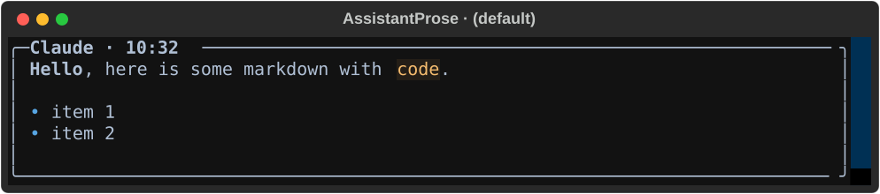
<figcaption>Role rails: user green (<code>$user-border</code>) vs assistant blue-grey (<code>$assistant-fg</code>). Both carry a matched identity header inside the primitive's body slot — <code>You · HH:MM:SS</code> and <code>&lt;agent&gt; · HH:MM</code> respectively — so the transcript reads as a two-sided conversation, not a monologue with prompts (qol-081).</figcaption>
</figure>

<figure markdown>
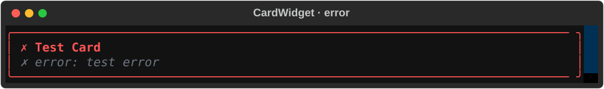
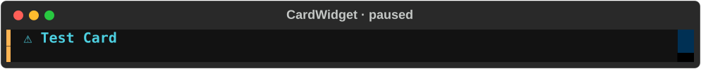
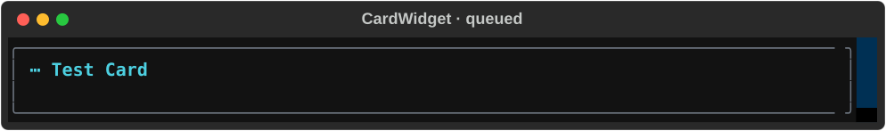
<figcaption>CardWidget state rails: error red (<code>$error</code>), paused amber (<code>$warning</code>), queued dim (<code>$hint</code>).</figcaption>
</figure>

<figure markdown>
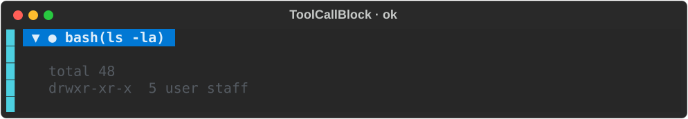
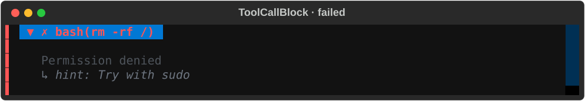
<figcaption>State-colored left rail + <code>CollapsibleTitle</code>
text: cyan when ok (<code>$tool-fg</code>), red when failed
(<code>$error</code>). Tiles captured unfocused; when focus is inside
the collapsible, Textual's default focus outline highlights the
<code>CollapsibleTitle</code> child (not the rail — see the Focus
subsection above).</figcaption>
</figure>

## Semantic usage rules

Hue is meaning, not decoration. Use the variable that matches the role or
state; do not pick a color for its own sake.

| Meaning | Color | Variable |
|---|---|---|
| user turn / user identity | green | `$user-border` |
| assistant prose / assistant frame | blue-grey | `$assistant-fg` |
| tool calls, completed / "done" states, compaction | cyan | `$tool-fg` |
| error, failed | red | `$error` |
| warning, paused, awaiting approval | amber | `$warning` |
| hint, disabled, cancelled, low-emphasis | grey | `$hint` |
| inset background (info bar, slash popup) | near-black | `$chat-surface` |

<figure markdown>
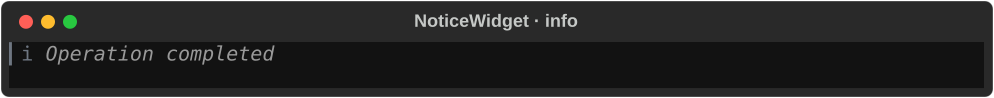
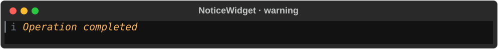
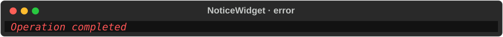
<figcaption>Severity mapping on <code>NoticeWidget</code>: info (<code>ℹ</code>), warning (<code>⚠</code>, amber), error (<code>✗</code>, red). Each notice leads with its severity glyph in both colour and mono modes — the glyph is the redundant carrier so a user in <code>NO_COLOR</code> or with a colour-vision difference still reads severity from shape, not hue alone (<code>notice.py:SEVERITY_GLYPHS</code>, qol-080).</figcaption>
</figure>

## NO_COLOR / mono strategy

Under `NO_COLOR`, `mono.tcss` replaces all seven palette variables with
`ansi_default` — the terminal's own default foreground — and role/state is
carried by **text style** instead of hue.

!!! warning "`ansi_default`, not `auto`"
    The mono variables map to `ansi_default`, **not** `auto`. `auto` is
    legal only for text `color:` (it computes an auto-contrast foreground
    against the rendered background); it is **illegal in `border:`**. Since
    the palette variables are used in border properties too (see the table
    above), `auto` made every border-using widget fail stylesheet parse and
    crash under `NO_COLOR`. `ansi_default` is legal for both `color:` and
    `border:` and defers to the terminal's foreground. See
    `process/bug-073-no-color-border-auto-crash.md`. (This was fixed in the
    spec-071 pass, so it is *not* an open item in the backlog below.)

Color → text-style mapping (`mono.tcss:12–21` documents the intent;
widgets do the per-role work in their own `DEFAULT_CSS`):

| Role / state | Text style | Example |
|---|---|---|
| identity / action | `bold` | `card_widget.py`, `info_bar.py`, `approval_block.py` |
| hint / disabled / low-emphasis | `dim` | `compaction_block.py`, `tool_call_block.py` |
| secondary / de-emphasized | `italic` | `card_widget.py`, `notice.py` (`dim italic`) |
| focus / selection | `reverse` | `_gutter_block.py` (primitive `:focus-within` rule, qol-079) |

Severity glyphs (`ℹ` / `⚠` / `✗`) are retained under `NO_COLOR` as
information carriers per the redundant-carriers rule — see the callout
at the top of this page. `NoticeWidget` prepends its severity glyph
unconditionally (`notice.py:SEVERITY_GLYPHS`, qol-080), and
`mono.tcss`'s header comment documents the same intent. Syntax
highlighting is suppressed too: `AssistantProse` swaps `MarkdownFence`
for a `_PlainFence` that returns plain dim monospace instead of running
Pygments when `NO_COLOR` is set (`assistant_prose.py:16–20`,
`assistant_prose.py:154–167`).

<figure markdown>
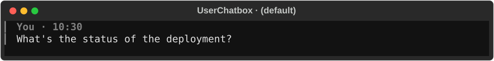
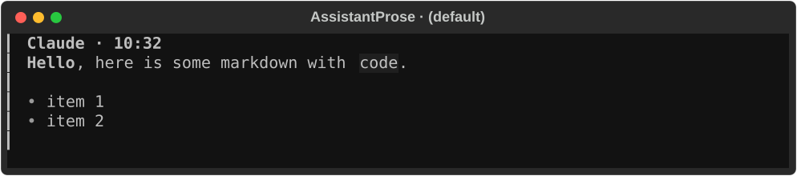
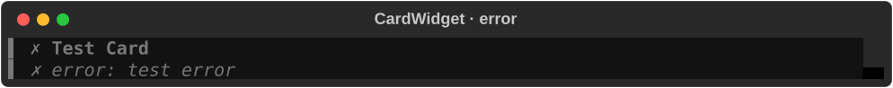
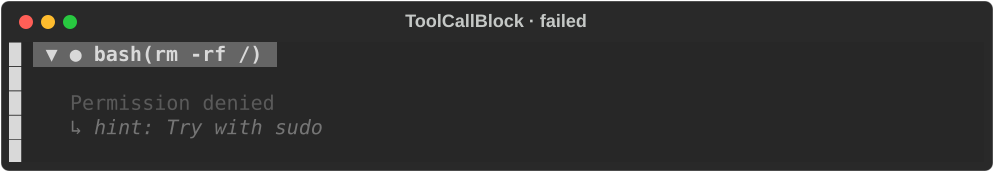
<figcaption>Mono variants (<code>ansi_default</code> + text-style). The same widgets as above, rendered under <code>NO_COLOR</code>: hue is gone, structure and emphasis remain — the assistant identity header still leads with <code>bold</code> weight.</figcaption>
</figure>

## Palette-bypass backlog

Closed by `qol-074`: every property-value hex under
`src/cli/chat/widgets/**` now routes through a palette variable, and the
duplicated `#1a1d24` inset background was promoted to `$chat-surface`. The CI
lint (`scripts/lint_chat_hex.py`) keeps the tree honest — property-value
hex fails; the canonical `$var: #hex;` fallback declarations documented
above pass.

## Regenerating the gallery

The SVGs above are a curated subset. To regenerate the full widget gallery
(all 27 widgets × states, color + mono):

```
uv run python -m scripts.chat_styleguide
```

This writes `build/gallery.html` (gitignored). Open it to eyeball every
widget's real render. The harness is documented in spec-071.
