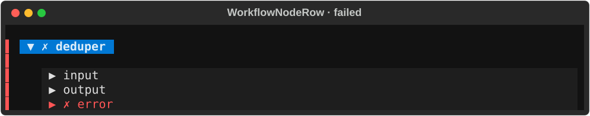
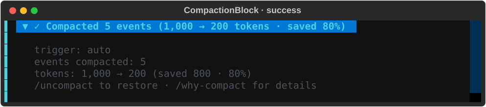
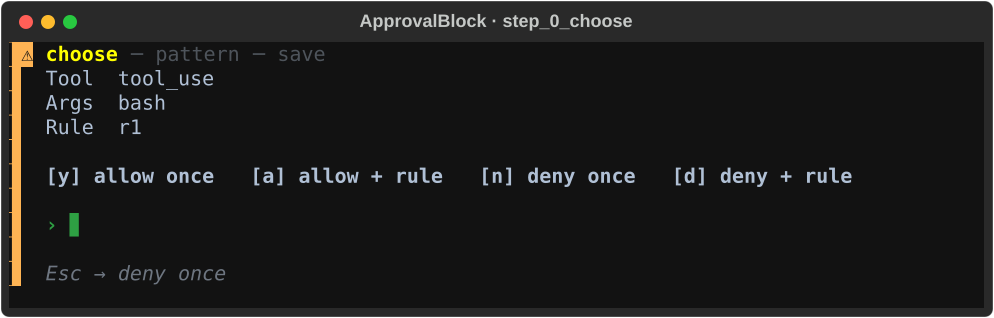
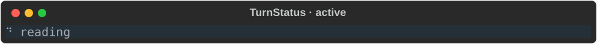
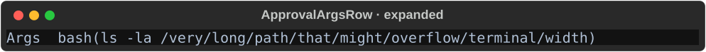

# Chat styleguide

Spacing, symbol, metric, and border conventions for the kolsch chat TUI
widgets (`src/cli/chat/widgets/**`). This page **documents the current
conventions and flags the inconsistencies** it found — it does not change
any CSS. Flagged items (⚑) feed a later normalization pass.

For the color palette, border colors, and the NO_COLOR strategy in full,
see the companion [chat color guide](chat-color-guide.md). Every citation
below is `file:line` against the code on branch
`feature/spec-072-chat-styleguide` and was grep-verified when written;
line numbers drift, so re-verify before relying on a specific line.

The renders on this page are SVG tiles from the spec-071 capture harness.
Regenerate them (and the full gallery) with:

```bash
uv run python -m scripts.chat_styleguide   # → build/gallery.html
```

---

## 1. Layout & spacing scale

**Spec-078 update:** the chat stream shares one primitive — `GutterBlock`
(`src/cli/chat/widgets/_gutter_block.py`) — a 2-cell left rail plus an
optional leading glyph column plus a body slot. Every widget in the
transcript stream inherits from or composes it (or, for base-class-
locked widgets like `Composer` / `ToolCallBlock` / `CompactionBlock` /
`CardWidget` / `WorkflowNodeRow`, uses `border-left: outer $color` as
the equivalent visual). Five widgets stay borderless / bare and do NOT
migrate: `TurnStatus`, `StatusBar`, `InfoBar`, `SlashPopup`,
`ScrollbackCue` — fixed chrome and transient overlays, not stream rows.

Three values carry almost all of the widget spacing. They form the de-facto
scale:

```
rail      GutterBlock ▎ + 1 col pad         2-col left column, always on ← primitive anchor
breather  margin:  0 0 1 0                  1 row below block            ← gap between blocks
indent    padding: 0 0 0 1    ↳ nested      1 col left only              ← hierarchy / nesting
```

The rail is rendered as an actual column of `▎` (U+258E LEFT ONE EIGHTH
BLOCK) via a `_GutterRail` Widget's `render_line`. Textual's built-in
border styles top out at `▊` (`tall`/`panel`, right edge only); rendering
`▎` as widget content is what preserves the exact glyph the design
review calls for. Widgets bound to base classes that make full
composition infeasible (Collapsible / TextArea) use `border-left: outer`
— Textual's `outer` paints `▌` on the left, one glyph wider than `▎`
but visually reads as the same "colored left rail per state".


### Value → widgets table

Built from a scan of every `DEFAULT_CSS` under `src/cli/chat/widgets/**`
for `padding:` / `margin:` declarations (single-side variants listed
separately below).

| Value | Role | Widgets (`file:line`) |
|-------|------|------------------------|
| `padding: 0 1` | **gutter** (1 col L/R) | `approval_block.py:118`, `assistant_prose.py:203`, `card_widget.py:181`, `composer.py:52`, `force_kill_confirm.py:81`, `notice.py:40`, `slash_popup.py:104`, `user_chatbox.py:51`, `workflow_node_row.py:273` |
| `margin: 0 0 1 0` | **breather** (1 row below) | `approval_block.py:119`, `assistant_prose.py:204`, `card_widget.py:182` |
| `padding: 0 0 0 1` | **indent** (1 col left) | `approval_block.py:166` |
| `padding: 0` | zero-inset container | `card_body/confirm.py:30`, `card_body/progress.py:30`, `card_prompt_pane.py:36`, `node_section.py:34`, `notice_slot.py:34` |
| `margin: 0` | zero-margin container | `node_section.py:35`, `workflow_node_row.py:273` |

Single-side spacing (used for finer intra-widget layout):

| Value | Widgets (`file:line`) |
|-------|------------------------|
| `margin-left: 1` | `turn_status.py:86`, `turn_status.py:90` |
| `margin-left: 0` | `status_bar.py:77` |
| `margin-left: 2` | `approval_save_confirm.py:54` |
| `margin-right: 1` | `info_bar.py:57` |
| `margin-top: 1` | `approval_block.py:151`, `approval_block.py:155`, `approval_choice_pane.py:61`, `approval_save_confirm.py:66` |

**⚑ Spacing outliers** (feed the normalize pass):

- `force_kill_confirm.py:82` uses `margin: 1 0` (a row *above and below*),
  the only widget with a top breather — every other block uses
  `margin: 0 0 1 0` (below only).
- `approval_save_confirm.py:54` uses `margin-left: 2` (two-col indent),
  divergent from the `padding: 0 0 0 1` one-col indent used elsewhere.

---

## 2. Symbols & glyphs

Every widget looks state glyphs up through
`src/cli/chat/state_tokens.py` — the canonical `STATE_TOKENS` table
maps a single state vocabulary to `(glyph, color, text_style)`.
Legacy widget-specific state names (`completed`, `error`,
`initializing`, `starting`, `pruned`) still resolve via
`_LEGACY_ALIASES` with a `DeprecationWarning` (qol-075).

| Glyph | Means | Placement | Canonical state (`state_tokens.py`) | Other users |
|-------|-------|-----------|--------------------------------------|--------------|
| `✓` | terminal success | leading title glyph | `success` | `compaction_block.py:208` (`success`) |
| `✗` | terminal failure | leading title glyph | `failed` | `compaction_block.py:210` (`failure`), `node_section.py:39` (error color) |
| `⧗` | cancelling | leading title glyph | `cancelling` | — |
| `⚠` | paused / warning | leading title glyph | `paused`, `awaiting` | — |
| `─` | pruned / cancelled | leading title glyph | `cancelled` (legacy `pruned` aliases) | — |
| `▸` | running (static) / collapsed | leading glyph **and** collapse chevron | `running` (legacy `starting` aliases) | `approval_args_row.py:65` (`_CHEVRON_COLLAPSED`) — ⚑ **double meaning** |
| `▾` | expanded | collapse chevron | — | `approval_args_row.py:66` (`_CHEVRON_EXPANDED`) — pairs with `▸` |
| `⋯` | queued | leading title glyph | `queued` (legacy `initializing` aliases) | — |
| `…` | truncation ellipsis | trailing, in overflow | — | `approval_args_row.py:67` (`_ELLIPSIS`) |
| `⠋…` (10) | spinner — active turn / active node | leading glyph (animated) | — | `src/cli/chat/spinner.py` (`SPINNER_FRAMES`), imported by `turn_status.py` and `workflow_node_row.py` |
| `↳` | nested / "from" connector | gutter before a hint line | — | `card_body/workflow.py:258,261` (`↳ from <ref>`), `tool_call_block.py:126` (`↳ hint:`) |
| `●` / `○` | breadcrumb done / pending | header breadcrumb | — | `approval_block.py:578,581,584` (`● choose ─ ○ pattern ─ ○ save`) |
| `●` | tool-call / compaction marker | leading title glyph | — | `tool_call_block.py:104` (`● {tool}`), `compaction_block.py:207` (`● Compacting…`) |
| `◎` | compaction preview | leading title glyph | — | `compaction_block.py:209` |
| `↷` / `↶` | compaction skipped / restored | leading title glyph | — | `compaction_block.py:211,212` |







### State vocabulary

The canonical state names (source of truth: `src/cli/chat/state_tokens.py`):

| Canonical state | Glyph | Palette color | Text style | Legacy aliases |
|-----------------|-------|---------------|------------|----------------|
| `success`    | `✓` | `$tool-fg` | `bold` | `completed` |
| `failed`     | `✗` | `$error`   | `bold` | `error` |
| `running`    | `▸` | `$tool-fg` | `bold` | `starting` |
| `queued`     | `⋯` | `$hint`    | `dim`  | `initializing` |
| `paused`     | `⚠` | `$warning` | `bold italic` | — |
| `awaiting`   | `⚠` | `$warning` | `bold italic` | — |
| `cancelling` | `⧗` | `$warning` | `bold italic` | — |
| `cancelled`  | `─` | `$hint`    | `dim`  | `pruned` |

Legacy alias resolution emits a `DeprecationWarning` (see the
`_LEGACY_ALIASES` table); the aliases are the one-release bridge for
widgets whose reactive `state` still uses the historical vocabulary.

### Spinner alphabet

One 10-frame dot-cycle `⠋⠙⠹⠸⠼⠴⠦⠧⠇⠏` (`src/cli/chat/spinner.py`)
backs every "work in progress" animation on the chat surface — the
active-turn status line and the active workflow-node title both
index into it. See qol-076.




### ⚑ `▸` double meaning

`▸` is both the **running-state glyph** (`STATE_TOKENS['running']` in
`src/cli/chat/state_tokens.py`) and the **collapsed-chevron** for
collapsible rows (`_CHEVRON_COLLAPSED`, `approval_args_row.py:65`). Note
that while a node is *animating* it actually renders the braille spinner
(`workflow_node_row.py` picks `_SPINNER_FRAMES` for animated states),
so `▸` is the static/non-animating running glyph — but it still
collides with the collapse chevron's meaning.



---

## 3. Metrics

qol-077 consolidated every duration / counts / progress / byte
formatter into `src/cli/chat/metrics.py`. Callers pass in the raw
number and get back the canonical string; any framing chrome
(parens around the turn-status elapsed, separator dots in the
compact summary) stays widget-specific.

| Metric | Format | Helper · call sites (`file:line`) |
|--------|--------|-----------------------------------|
| Duration | `Ns` under 60, else `Mm SSs` — e.g. `3s`, `1m 04s`, `12m 30s`. Negative clamps to `0s`. Optional keyword-only `sub_second_precision=N` (qol-085) applies ONLY below 1s so bash-node exit lines keep a `0.4s` signal; the ≥1s branches are unaffected. | `metrics.py::format_duration` — `turn_status.py` (`#elapsed`, wrapped in parens); `card_body/workflow.py` (workflow-card header, compact summary, terminal footer); `services/workflow_layout.py` (live-workflow strip); `widgets/workflow_node_row.py` (bash-node exit line, `sub_second_precision=1`) |
| Counts | Bare `N/M` — no brackets, no padding. | `metrics.py::format_counts` — `card_body/workflow.py` (workflow-card header + compact summary); `services/workflow_layout.py` (live-workflow strip) |
| Progress bar | `▓`×filled + `░`×remainder, fixed 8 cells (override via `width=`). `total<=0` renders all-empty. | `metrics.py::format_progress` — `card_body/workflow.py` (workflow-card header) |
| Byte size | `N B` under 1 KB, then `1.0 KB` / `1.4 MB` / `2.0 GB` / `250 MB` (1 decimal under 100, 0 decimals at/above). | `metrics.py::format_bytes` — no live caller yet; shipped for the next surface that needs it (spec-078 gutter blocks; token counters). |


Widget-specific chrome around the number stays local:

- `TurnStatus` wraps the elapsed in parens: `({format_duration(seconds)})`
  → `(3s)` / `(2m 05s)`.
- `WorkflowRenderer` composes `counts  bar  duration` with a
  double-space separator; the compact summary and live strip use
  `·` between fields.

The pre-qol-077 §"Metric inconsistencies" (two elapsed formats,
bracketed vs bare counts, missing byte-size row) is closed — every
row above cites one shared helper.

---

## 4. Borders & focus

**Spec-078 update:** round frames + heavy over/under rails are gone
across the transcript stream. Every migrated widget now delivers its
role/state signal via a colored left rail — either the exact `▎`
glyph via the `GutterBlock` primitive (`_gutter_block.py`) or a
`border-left: outer $color` (`▌` — Textual's closest border style)
on widgets bound to base classes that can't be wrapped without
breaking their contract.

| Rail source | Widgets |
|-------------|---------|
| GutterBlock primitive (exact `▎`) | `user_chatbox.py`, `assistant_prose.py`, `approval_block.py`, `notice.py`, `force_kill_confirm.py` |
| `border-left: outer $color` (`▌`) | `card_widget.py`, `tool_call_block.py`, `compaction_block.py`, `workflow_node_row.py`, `composer.py` |

Focus indicator: unified across the surface via one selector pair
in the `GutterBlock` primitive (qol-079):

```css
GutterBlock:focus-within > .gb-glyph-col { text-style: reverse; }
GutterBlock:focus-within > .gb-rail       { text-style: reverse; }
```

Both fire together — on widgets with a leading glyph (`⚠` for
`ApprovalBlock` / `NoticeWidget`, ℹ/✗ for other notice severities),
the glyph inverts; on glyph-less widgets (`UserChatbox`,
`AssistantProse`), the rail's `▎` inverts as the fallback cue; on
widgets with both, the entire leftmost strip lights up bright. One
mechanic, one selector pair, applied uniformly by the primitive —
no per-widget focus CSS. `reverse` survives `NO_COLOR` for free (the
terminal inverts fg/bg) and doesn't reflow, so no layout shift on
focus arrival. For base-class-locked widgets (Collapsible / TextArea)
that don't compose a GutterBlock, Textual's default focus outline
applies to the focused child instead.

Rail-color routing keys off palette variables (`$user-border`,
`$assistant-fg`, `$warning`, `$tool-fg`, `$error`, `$hint`) — the
color guide's [border-color conventions](chat-color-guide.md#border-color-conventions)
lists the per-state mapping. The GutterBlock primitive resolves
palette-var slot values via per-class CSS rules baked into its
`DEFAULT_CSS` (`GutterBlock.-rail-<stem> > .gb-rail { color: $<stem>; }`)
so palette-var resolution happens in the stylesheet where it works,
not via inline `styles.color` (which rejects palette-var strings).


---

## 5. NO_COLOR / mono

Brief — see the color guide's
[NO_COLOR / mono strategy](chat-color-guide.md#no_color-mono-strategy) for
the full mapping and rationale.

Under `NO_COLOR`, `mono.tcss` replaces the six palette variables with
`ansi_default` (the terminal's own foreground — **not** `auto`, which is
illegal in `border:`; see `process/bug-073-no-color-border-auto-crash.md`).
Role and state are then carried by **text style** instead of hue:

| Color role | Mono text-style |
|------------|------------------|
| identity / action | `bold` |
| hint / disabled | `dim` |
| secondary | `italic` |
| focus | `reverse` |

Information-bearing glyphs (`⚠`, `✓`, `✗`, spinners) are retained under
NO_COLOR — they carry meaning, not decoration.

---

## 6. Inconsistency backlog

Consolidated flags with verified `file:line`, feeding the normalization
pass. (Palette/color bypasses live in the color guide's
[palette-bypass backlog](chat-color-guide.md#palette-bypass-backlog); not
duplicated here.)

| # | Inconsistency | Locations |
|---|---------------|-----------|
| 1 | ~~**Two spinner alphabets**~~ — resolved by qol-076: `src/cli/chat/spinner.py` now owns the single canonical 10-frame table (`SPINNER_FRAMES`); both `turn_status.py` and `workflow_node_row.py` import it. | ~~`turn_status.py:33` vs `workflow_node_row.py:60`~~ |
| 2 | ~~**Divergent state-glyph maps**~~ — resolved by qol-075: `src/cli/chat/state_tokens.py` now owns the single canonical table (`STATE_TOKENS`); widget-specific legacy names resolve via `_LEGACY_ALIASES` with a `DeprecationWarning`. | ~~`workflow_node_row.py:281` vs `card_widget.py:637`~~ |
| 3 | **`▸` double meaning** — running-state glyph and collapsed chevron | `state_tokens.py` (`running`) & `approval_args_row.py:65` |
| 4 | ~~**Two elapsed formats**~~ — resolved by qol-077 + qol-085: `src/cli/chat/metrics.py` now owns the single canonical `format_duration` (`Ns` under 60, `Mm SSs` above); every widget with a duration routes through it. qol-085 closed the last drift by adding a keyword-only `sub_second_precision` opt-in (applies only below 1s) and migrating the two `workflow_node_row.py` bash-timing sites. | ~~`turn_status.py:36` vs `card_body/workflow.py:251` vs `workflow_node_row.py:647,651`~~ |
| 5 | ~~**Two count formats**~~ — resolved by qol-077: `src/cli/chat/metrics.py:format_counts` returns bare `N/M`; every call site migrated. | ~~`card_body/workflow.py:251` vs `:1078`~~ |
| 6 | ~~**Spacing outliers**~~ — `force_kill_confirm.py`'s `margin: 1 0` outlier resolved by spec-078 (now composes a `GutterBlock` inheriting the primitive's `margin: 0 0 1 0`). `approval_save_confirm.py:54` `margin-left: 2` unchanged. | `approval_save_confirm.py:54` (residual) |
| 7 | ~~**Round-frame vs borderless-with-rules vs bare-colored-text**~~ — resolved by spec-078: one primitive (`GutterBlock`) delivers a colored left rail + optional leading glyph column across all ten migrated widgets. Round frames + heavy over/under bars removed; Collapsible/TextArea subclasses use `border-left: outer $color` as the equivalent visual. | (resolved) |
| 8 | **Palette/color bypasses** | see [color guide backlog](chat-color-guide.md#palette-bypass-backlog) |
